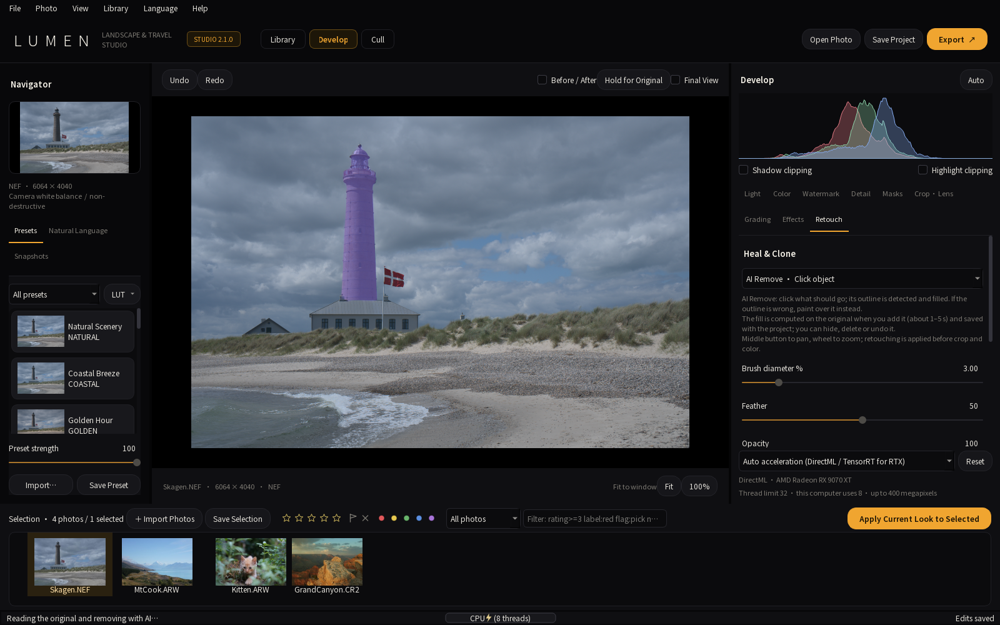
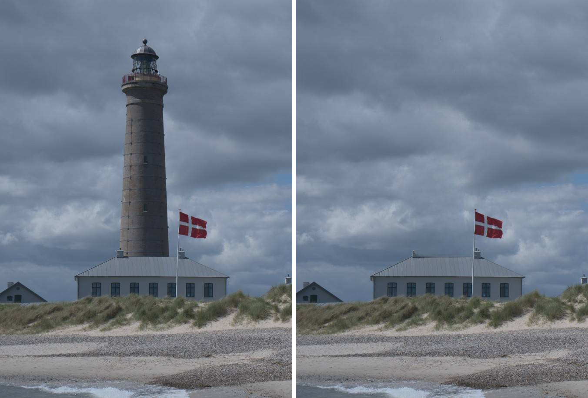
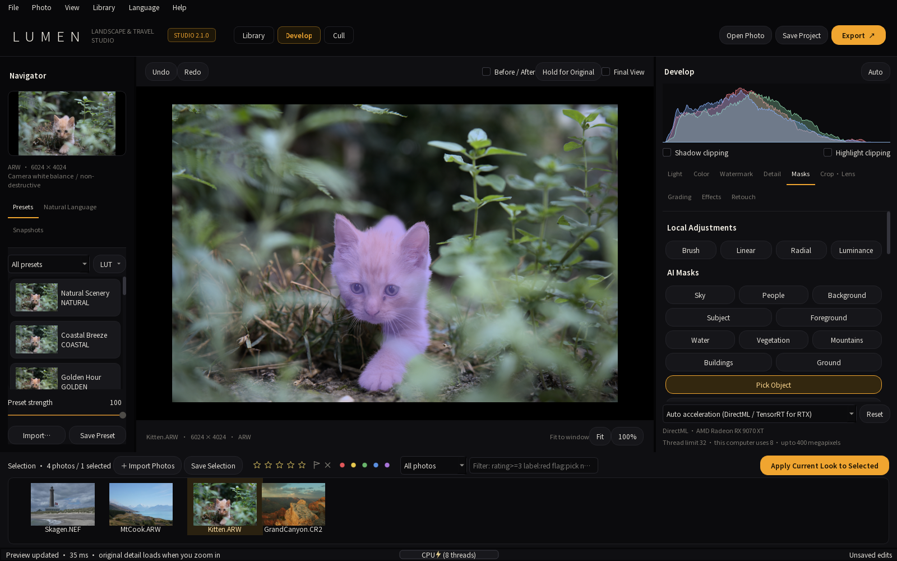
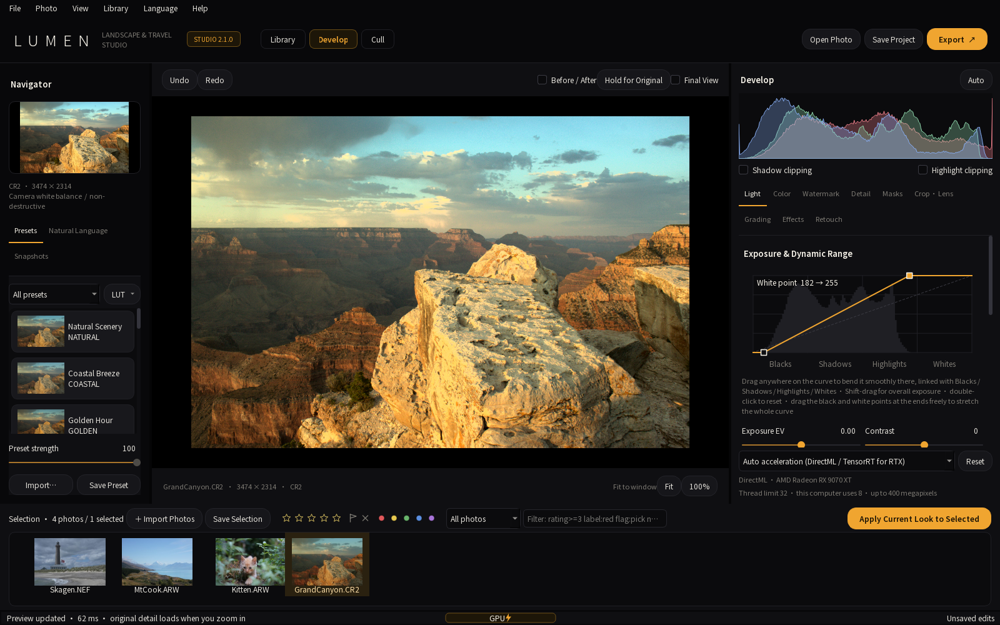
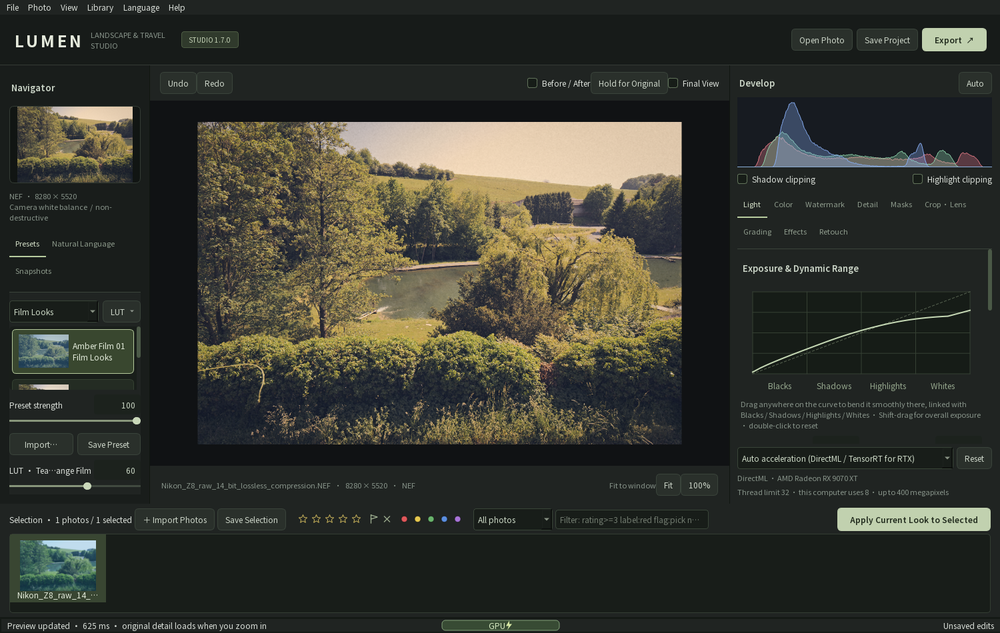
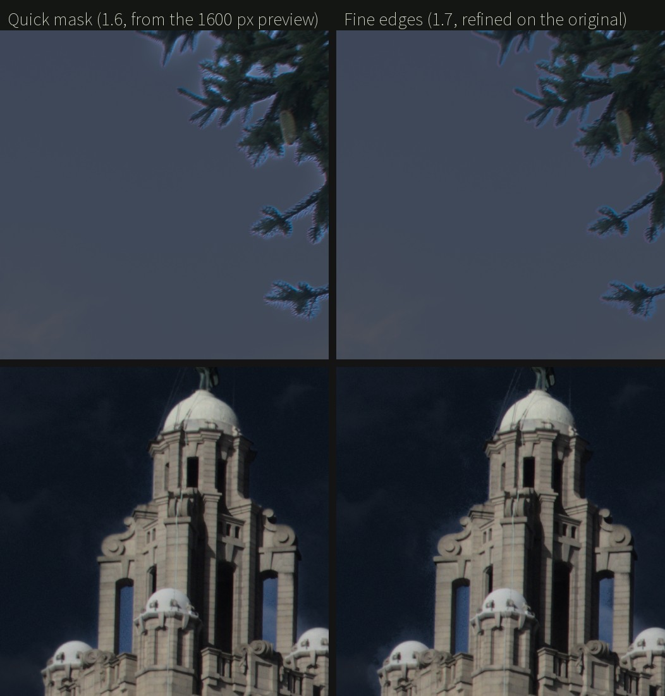
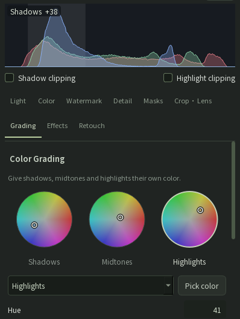
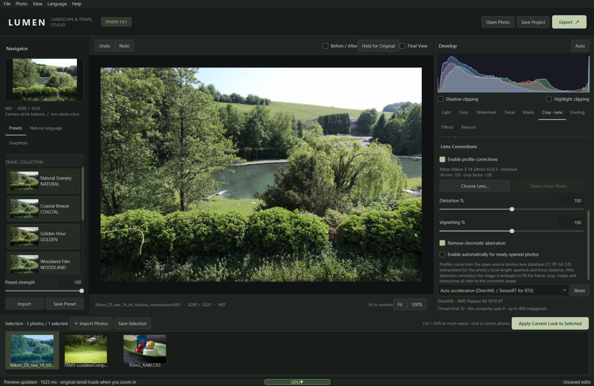
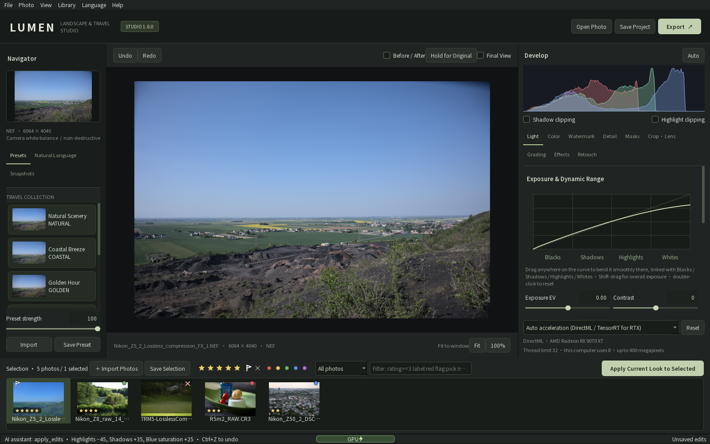

# LUMEN RAW

**An open-source RAW photo editor: a photo library and fast culling, color grading, lens corrections, AI object removal, AI enhancement, smart masks, photo merging, time-lapse videos — and editing by describing the look in one sentence.**

[中文说明](README.zh-CN.md) · [Downloads](https://github.com/hety0211/lumen-raw/releases) · [Changelog](CHANGELOG.md) · [Contributing](CONTRIBUTING.md) · [MIT license](LICENSE)

LUMEN RAW is a local desktop editor for landscape and travel photography on Windows, Apple silicon Macs and x86_64 Linux (from source). No account is required. The interface is available in nine languages: English, 简体中文, 繁體中文, 日本語, 한국어, Deutsch, Français, Español and Русский. Importing, culling, editing, lens corrections, AI object removal / denoising / super-resolution / masks, export and time-lapse videos all run offline on your computer. The network is used only when you choose a cloud language model for natural-language editing, once to download the speech model if you use voice instructions, and (from 2.1.1) to check for a new version at start-up, which you can switch off.

Current version: **2.1.1** (Windows, 2026-10-26). macOS: 2.1.0 (2026-10-23). Linux: run or build from source (the Linux port arrived with 2.1.1).


Actual application screenshots. The photographs are public test samples: CC0 photos from raw.pixls.us and Play Raw photos from discuss.pixls.us under CC BY-SA 4.0 ([image credits](docs/screenshots/README.md)).

## Download and install

| System | Download | Requirements |
|---|---|---|
| Windows | [`LumenRAW-2.1.1-Setup.exe` (full installer, 597 MB), `LumenRAW-2.1.1-Update.exe` (update package, 135 MB) or `LumenRAW-2.1.1-Windows.zip` (portable, 665 MB)](https://github.com/hety0211/lumen-raw/releases/tag/v2.1.1) | Windows 10 22H2 / Windows 11, x64 |
| macOS | [`LumenRAW-2.1.0-macOS-arm64.dmg` (654 MB)](https://github.com/hety0211/lumen-raw/releases/tag/v2.1.0-macos) | Apple silicon (M1 or newer), macOS 15 Sequoia or later |
| Linux | No prebuilt download: run from source ([below](#run-from-source)); `tools/build_linux.sh --sample photo.DNG` builds a portable `LumenRAW-<version>-Linux-x86_64.tar.gz` | x86_64, Python 3.12; an NVIDIA GPU with a CUDA 13 driver is optional |

Windows is at 2.1.1: in-app updates, AI models kept apart from the program, sharpness and closed-eye analysis switched on separately, DeepSeek Harness, Xiaomi MiMo and five fixes from a code review. macOS stays at 2.1.0, the first Mac build since 1.7.0, which also brings 2.0's library, culling, preview cache, time-lapse videos and themes. Linux (x86_64) runs from source from 2.1.1 on, with native CUDA kernels on NVIDIA GPUs (a community contribution, see [Download and install](#download-and-install)). 2.1.1 keeps project format 8, so 2.1.0 and 2.1.1 open each other's projects. 2.1.0 saves projects (`.lumen`) and albums (`.lumenalbum`) in format 8 (for AI removals and the new masks): 2.1.0 opens every older project, but 2.0.1 and earlier cannot open those saved by 2.1.0. Each release lists SHA-256 checksums. The binaries are not code-signed with a commercial certificate.

**Windows**

- **Installer:** installs for the current user without administrator rights and upgrades 1.2.x – 2.1.0 in place. From 2.1.0 the update package (135 MB) is enough: it carries no AI models and keeps the ones 2.1.0 installed. Save your album and close the old version first. The language you choose when the installer starts becomes the interface language; change it later in the **Language** menu.
- **Portable:** extract and run `LumenRAW-Windows\LumenRAW.exe`. Keep the `_internal` and `models` folders next to the exe. The portable build follows the system language until you choose one.
- Both include Python, ExifTool, fonts, the fifteen AI models, the video encoders and the lensfun lens database, and work fully offline. The speech model for voice instructions (about 240 MB) is downloaded the first time you click **Voice**; when you upgrade from 1.5 – 1.7, the installer keeps the model those versions bundled, so it is not downloaded again.
- From 2.1.1 the AI models (about 522 MB) live in the `models` folder next to the program, apart from it: in-app updates download only the program (about 135 MB) and the models that changed; see [Updates and AI models](#updates-and-ai-models). AI models are stored at half precision (results differ by about 0.001 %, at the same speed), and the speech model is not bundled.

**macOS**

- Open the DMG and drag **LUMEN RAW** to Applications (replacing an older copy).
- The interface starts in the first supported language of System Settings → General → Language & Region (or the language set for LUMEN RAW under Applications there); change it in the **Language** menu. The 1.5.0 Mac build was Chinese-only, so a Mac whose first language is English now starts in English.
- The app is ad-hoc signed and not notarized by Apple, so the first launch is blocked. Open System Settings → Privacy & Security and click **Open Anyway**, or run `xattr -dr com.apple.quarantine "/Applications/LUMEN RAW.app"`.
- The first voice instruction asks for microphone access and, as on Windows, downloads the speech model once (about 240 MB) after you agree. Speech is recognized on the Mac and never uploaded.
- Cloud API keys are kept in the login keychain. After each update, macOS asks once whether the new build may read them; choose **Always Allow**.

**Linux**

- There is no published Linux download. `./run-source.sh` sets up and starts the editor from a checkout (see [Run from source](#run-from-source)); `tools/build_linux.sh` builds a portable archive with a menu entry for the current user.
- A built archive needs the glibc version of the system it was built on; to share it with older distributions, build on the oldest one you need.
- With an NVIDIA GPU, development runs in native CUDA kernels and the AI models use ONNX Runtime's CUDA execution provider; without one (or without the CUDA runtime) everything runs on the CPU. AMD and Intel GPUs are not used on Linux.
- The Linux port was contributed by [@worldcupfantasy](https://github.com/worldcupfantasy) (pull request #8) and tested by the contributor on an NVIDIA GPU with CUDA 13; the maintainer has not run it on Linux hardware, and it has not been checked on every distribution or desktop.

## Updates and AI models

From 2.1.1 LUMEN RAW checks for a new version in the background when it starts (it reads `lumen-update.json` on the latest GitHub release, sending only the program version). When there is one, the **LUMEN RAW — Software update** window shows the current and latest version, the download size and what changed:

- **Update now** downloads the update package and only the AI models this computer lacks (cancel at any time; it resumes next time), checks every file's size and SHA-256 and accepts files from this project's GitHub releases only. Then **Restart and update** closes LUMEN RAW (asking about unsaved edits as usual); the update package waits until it has exited, installs silently and opens the new version.
- **Remind me later** closes the window until the next start. **Help → Check for updates…** checks by hand; **Help → Check for updates at start-up** turns the automatic check off.
- **Only what changed is downloaded:** the fifteen AI models (about 522 MB) live in `models` next to `LumenRAW.exe`, named after their SHA-256 (e.g. `skyseg.b57ea5204f87.onnx`). The update package is the program alone (about 135 MB) and leaves `models` as it is; when a version replaces a model, only that model is downloaded. The full installer and the portable build still carry every model for offline installs.
- **Missing models** are offered for download at start-up and in **Help → AI models…** (command line: `lumen-cli models --download`); a feature whose model is missing says what to download, everything else keeps working.
- Portable copies, source runs (Linux included) and the macOS app open the download page instead.
- **Upgrading from 2.1.0:** 2.1.0 has no update check, so install 2.1.1 by hand once: the update package (135 MB) is enough, because it moves 2.1.0's models (identical in 2.1.1) into `models\import` and the editor adopts them after checking their SHA-256. From 2.1.1 on, the editor finds new versions itself.

## Features

- **In-app updates (2.1.1):** a new version is found at start-up, downloaded with one click and installed silently after the window closes; the AI models are kept apart from the program, so later updates download only the program (about 135 MB) and the models that changed.
- **Sharpness and closed eyes analysed separately (2.1.1):** two switches in the **Library** menu; landscapes can skip the face search, and turning the second analysis on later computes only that part.
- **DeepSeek Harness and Xiaomi MiMo (2.1.1):** one click in **AI assistants (MCP)** adds LUMEN RAW to DSH; natural-language editing adds Xiaomi MiMo and drops Qwen (Bailian), Doubao (Ark) and SiliconFlow.
- **Linux (2.1.1, community contribution):** x86_64 Linux runs from source, with native CUDA development kernels and CUDA AI models on NVIDIA GPUs. See [Download and install](#download-and-install).
- **AI removal (2.1.0):** paint over a distraction, or click it, and a local LaMa model fills it from its surroundings — people on a pier, a sign, a whole lighthouse. The fill is computed once on the original and saved with the project, so preview, zoom and export match. See [AI removal](#ai-removal).
- **Landscape masks and picked objects (2.1.0):** one click selects water, vegetation, mountains, buildings or the ground; **Pick Object** masks anything you click, Shift-click adds, Alt-click takes away. See [Landscape masks and picked objects](#landscape-masks-and-picked-objects).
- **Black and white points on the exposure curve (2.1.0):** drag the ends of the curve freely and the whole curve stretches between them, as when grading a log image in DaVinci Resolve; the histogram of the unedited photo sits behind the curve. See [Black and white points](#black-and-white-points-on-the-exposure-curve).
- **Library (2.0.0):** import folders into a catalog of your photos: a folder tree, a zoomable thumbnail grid, keywords and smart albums (saved searches by rating, keyword, camera, lens, date, sharpness, closed eyes, bursts …). Capture data, XMP ratings and keywords are read in the background; your files are never changed. See [Library](#library).
- **Fast culling (2.0.0):** full screen with the camera's own previews, so moving between photos is instant; side-by-side compare, 100 % zoom, Lightroom's rating keys. Bursts are grouped with the best frame marked, and possibly blurry photos and closed eyes are flagged (eyes by two small offline face models). See [Culling](#culling).
- **Smart preview cache (2.0.0):** a photo you opened before opens again in about 50 ms instead of 1–2 s, and the neighbors of the current photo are decoded ahead.
- **Time-lapse videos (2.0.0):** turn an interval sequence into an H.264, H.265, AV1 or ProRes video at the sensor's aspect ratio, with edits blended between keyframes and deflicker for auto exposure and auto white balance. See [Time-lapse videos](#time-lapse-videos).
- **New look, smaller download (2.0.0):** dark and light themes with amber accents that follow the system; the installer is less than half the size with every AI model still included; CPU previews are 3–4× faster.
- **Presets (1.7.0):** import Lightroom Classic / Camera Raw presets (`.xmp`, `.lrtemplate` or whole `.zip` packs), converted approximately to LUMEN settings with a list of what has no counterpart; `.cube` 3D LUTs as a new adjustment with a strength, saved in projects; presets in groups, applied to many photos at once; 12 built-in looks. See [Presets, Lightroom presets and LUTs](#presets-lightroom-presets-and-luts).
- **Fine AI mask edges (1.7.0):** sky, people, subject and background masks appear at once, then their edges are refined on the original at up to 4096 pixels: foliage, needles and building outlines without light halos. See [Fine AI mask edges](#fine-ai-mask-edges).
- **Histogram dragging and a grading eyedropper (1.7.0):** drag in the histogram to change blacks, shadows, exposure, highlights and whites, as in Lightroom; pick a color from the photo as a color-grading hue. See [Histogram dragging and the grading eyedropper](#histogram-dragging-and-the-grading-eyedropper).
- **Scene-referred color (1.6.0):** process version 2 keeps colors outside sRGB through the RAW decode, computes exposure, white balance and highlights / shadows in linear light (highlights / shadows as halo-free local tone mapping), works saturation, the color mixer and grading in OkLCh, and maps colors beyond sRGB keeping hue and lightness. Older projects look unchanged. See [Color and process versions](#color-and-process-versions).
- **Ratings (1.6.0):** stars, pick / reject flags and color labels with Lightroom's shortcuts and a field search; saved automatically, interchanged with XMP, importable from Lightroom catalogs. See [Ratings and filters](#ratings-and-filters).
- **AI assistants and command line (1.6.0):** Claude Code, Codex, WorkBuddy and other local assistants drive LUMEN RAW over MCP (visible in the window, undoable); `lumen-cli` renders from scripts. See [AI assistants (MCP) and the command line](#ai-assistants-mcp-and-the-command-line).
- **Lens corrections (1.5.1):** the lens is identified from EXIF and its distortion, vignetting and lateral chromatic aberration (purple / green edge fringes) are corrected with the open-source lensfun database. See [Lens corrections](#lens-corrections).
- **Nine interface languages (1.5.1):** switch any time from the **Language** menu; the installer offers the same languages.
- **Edit in one sentence (1.5):** type or say the look you want; a local or cloud language model of your choice returns the parameters, applied as one undoable step. See [Natural-language editing](#natural-language-editing).
- **RAW formats:** Sony ARW / SR2 / SRF, Canon CRW / CR2 / CR3, Nikon NEF / NRW, Fujifilm RAF (including X-Trans), Panasonic RW2, DNG and other formats supported by the bundled LibRaw, plus JPEG / PNG / TIFF. Nikon "High Efficiency" NEFs that LibRaw cannot decode open from their full-size embedded JPEG. For the Nikon Z50 II and Z5 II, which the bundled LibRaw does not list, LUMEN RAW supplies the colour matrix of their lossless NEFs.
- **Non-destructive development:** exposure, contrast, highlights / shadows / whites / blacks, an exposure curve you can bend anywhere, white balance (camera-recorded temperature and an eyedropper), 8-color HSL, RGB and per-channel curves, three-way color grading, monochrome, vignette and grain. 12 built-in looks with adjustable strength (importable and exportable), Lightroom preset and LUT import, auto adjust, snapshots, undo / redo.
- **Detail and retouching:** dehaze, clarity, texture, sharpening, luminance and color noise reduction; spot healing, clone stamp and AI removal.
- **Masks:** brush, linear and radial gradients, luminance range, similar-color selection, local AI models for sky, people, subject, background, foreground, water, vegetation, mountains, buildings and ground, and objects picked with a click. Invert, feather, opacity and brush refinement; up to 32 masks per photo.
- **AI enhancement:** Real-ESRGAN 2× / 4× super-resolution and DRUNet / NAFNet / FFDNet denoising, each with its own preview dialog. Results are saved as editable DNG copies.
- **Photo merging:** focus stacking, HDR stacking (Mertens exposure fusion with three deghosting levels) and panoramas up to 200 megapixels, from 2–32 photos.
- **Batches:** multi-select in the library grid or the filmstrip with Ctrl / Shift, copy the current edit to the selection, apply presets to many photos, or batch-export JPEG / PNG / TIFF / DNG with an optional long-edge size.
- **Large images:** 100% view of original pixels, rendering only what is on screen. Editing a zoomed 61-megapixel photo keeps GUI stalls to about 40 ms. Before / after, hold-for-original and clipping warnings.
- **Watermarks and export:** four border styles with shooting information and the camera and lens brand logos picked from EXIF. Export JPEG / PNG (8-bit), TIFF (16-bit) and linear DNG (16-bit), up to 400 megapixels, in sRGB, Display P3 or Adobe RGB, optionally with a JPEG size limit in KB, keeping the original's EXIF, IPTC and XMP (camera, lens, capture settings, copyright, keywords; GPS optional).

## AI removal





In the **Retouch** panel, the tool menu has two AI tools next to spot healing and the clone stamp:

1. **AI Remove · Paint object:** paint over what should go, with a little of its edge and shadow, and release. The brush size, feather and opacity sliders apply as for healing.
2. **AI Remove · Click object:** click the object; its outline is found by the object model (slightly grown, to take fringes and soft shadows) and filled. When the outline is wrong, paint instead.

- The local LaMa model (big-lama) fills the area from its surroundings. The fill is computed on the full-resolution original, with as much surrounding picture as the area itself on every side, scaled to at most 1024 pixels for the model; on a large area it is enlarged, so the grain measured around the area is added back.
- The result is computed once, when you add it, and stored with the project as a 16-bit patch (a generative fill computed again at another size would come out different). Preview, every zoom level and export are therefore identical. The patch holds linear values before white balance, so later white balance, exposure and color changes apply to it as to the rest of the photo.
- Removals queue up while the preview keeps updating; the painted stroke stays amber until its fill is done. Each one is listed and can be hidden, deleted or undone, and its opacity applies. Export waits until all removals are done. Masks look at the retouched photo, so a removed object is never selected again.
- On a Ryzen 7 9800X3D: removing three people from an 18-megapixel CR2 took 2.8 s, and a whole lighthouse from a 24-megapixel NEF 4.8 s, including finding its outline and reading the original the first time.

## Landscape masks and picked objects



- **Water, Vegetation, Mountains, Buildings, Ground:** one network (EfficientViT-Seg B2, trained on the 150 classes of ADE20K) finds all five groups at once, in about 0.25 s on the CPU. Water covers water, sea, rivers, lakes, pools and waterfalls; vegetation trees, grass, plants, fields, flowers and palms; mountains mountains, hills and rocks; buildings buildings, houses, skyscrapers, towers, bridges, walls, columns, huts and piers; ground the ground, roads, pavements, earth, sand, paths, tracks and dirt roads. Like the sky and people masks, they appear at once from the preview and their edges are then refined on the original.
- **Pick Object:** turn it on and click anything in the photo: EfficientViT-SAM L0 (an efficient Segment Anything) outlines it. The first click encodes the whole picture (about 0.5–1 s), then each click takes about 15 ms plus 0.3 s to align the mask with the photo's edges. Shift-click adds (another part, or the next of several things), Alt-click (`Option` on a Mac) takes away: the whole object under that click is removed, unless it holds an added click, then only the part you marked. The clicks are saved with the project.
- The five groups and objects are also available to natural-language editing, the command line and MCP as regions `water`, `vegetation`, `mountain`, `building`, `ground` (also "lake", "trees", "beach" and so on).

## Black and white points on the exposure curve



- The two ends of the exposure curve (square handles) move freely, as when you stretch a log image with a curve in DaVinci Resolve: the black point to the right clips the darkest tones, upwards it lifts the blacks (a faded look); the white point to the left takes duller highlights to pure white, downwards it lowers the white level. The whole curve between them, including bends you made, keeps its shape and stretches; outside them it stays flat.
- The histogram of the unedited photo is drawn behind the curve, so you can see where a flat image's tones begin and end and drag the points there. While dragging, the curve shows the point's input → output (0–255).
- `Shift` keeps the movement horizontal or vertical; double-clicking an end resets only that end, double-clicking elsewhere resets the whole curve. The points change the curve only (saved in projects and presets like the fine curve of 1.4.1); the exposure, blacks and whites sliders keep their values.

## Library

The **Library** page (`G`; `D` returns to **Develop**) is LUMEN RAW's own catalog of your photos.

1. **Import:** **Import Folder…** (`Ctrl+Shift+I`, or drag a folder onto the grid) adds a folder and its sub-folders in the background, skipping recycle bins and system or hidden folders. Photos stay where they are; the library only records them (`library.db` in the data folder). Photos you open in the develop view join the library too.
2. **Browse:** on the left are the catalog (all photos, last import, the current selection), smart albums, the folder tree with photo counts, and keywords. The grid sorts by capture time, name, rating or import time; `Ctrl` + wheel or the slider sizes thumbnails from 96 to 320 pixels. Thumbnails show stars, flags, color labels, burst positions and hints.
3. **Rate and tag:** `0`–`5`, `P` / `X` / `U` and `6`–`9` act on the selected photos, as in the filmstrip. Type keywords in the info panel on the right (comma-separated, with completion); click × on a keyword to remove it.
4. **Open:** double-click or `Enter` opens the selection in the develop view (the photos join the filmstrip); `C` or `Space` starts [culling](#culling). Right-click to add photos to the selection, batch-export, show them in their folder, make a time-lapse, or remove them from the library (the files stay).

- **Search and smart albums:** the search box and **New Smart Album…** take the filter syntax of the filmstrip plus `keyword:` (a name, `any` or `none`; quote names with spaces), `camera:`, `lens:`, `iso`, `f`, `focal`, `date:2026-10` or `date>=2026-10-01`, `faces`, `eyes:closed`, `sharpness<30`, `burst` / `burst:best`, and the words `blurry`, `sharp`, `best`, `closed` and `missing`. Plain words search file names, keywords, cameras and lenses. Eight smart albums are built in: picked, ★3 and up, rejected, possibly blurry, possibly closed eyes, bursts, best of each burst and no keywords.
- **Capture data, ratings and keywords** are read by ExifTool, 64 photos at a time, with sub-second capture times. Stars, labels and keywords already in XMP sidecars or embedded XMP (from Lightroom, Bridge or the camera) appear in the grid. With **Write XMP Sidecars Automatically When Ratings Change** on, keywords are written to the sidecars too (`dc:subject`, as Lightroom does); the photos themselves are never written.
- **RAW / JPEG (2.1.0):** two check boxes above the grid show RAW files, JPEG files or both, handy when the camera shoots RAW + JPEG; culling started from the grid uses the same photos. DNG counts as RAW; PNG and TIFF are always shown.
- **Folders** can be rescanned (new photos are added, moved or deleted files marked as missing, and since 2.0.1 photos or XMP sidecars changed by another program are read again) or removed from the library.
- **Unreadable files:** when ExifTool cannot read a photo (a damaged file, a drive that is not connected), it is tried again a few minutes later; after three attempts the info panel shows why, and a rescan or right-click → **Read Capture Data Again** tries once more.

## Culling


**Cull** (`C`, or `Space` in the grid) shows the photos of the grid full screen — only the selected ones when several are selected. It can also start from the filmstrip.

| Action | Key |
|---|---|
| Next / previous photo | `→` / `←` |
| Next / previous burst | `↓` / `↑` |
| Stars / flags / labels | `0`–`5` / `P` `X` `U` / `6`–`9` |
| Advance after rating on / off | `A` |
| 100 % where you point, and back | `Z`, `Space` or click; drag to pan |
| Compare side by side | `C`; `Tab` switches the side you rate, `↑` keeps the candidate |
| Face boxes | `F` |
| Open in Develop / back to the library | `Enter` / `Esc` or `G` |

- **Speed:** culling shows the camera's own rendering — the JPEG preview inside the RAW file, decoded straight at the size needed — with three photos ahead and behind loaded in advance, so moving between photos is instant. 100 % uses the full-size embedded JPEG where there is one and reads the RAW otherwise.
- **Compare:** the left side keeps the chosen photo while `←` / `→` change the candidate on the right; both sides zoom and pan together.
- **Bursts:** consecutive photos from the same camera body (model and serial number), at most 2 s apart and with a similar picture, form a burst, shown as "3/7". The best frame of each (eyes open first, then the sharpest) is marked in amber, and **Collapse bursts** shows only those. Copies with the same name and time (exports, the JPEG of RAW + JPEG) are not bursts.
- **Sharpness and closed eyes:** every photo is analysed once in the background (at low priority, paused while AI or export runs) and the results are kept. From 2.1.1 the **Library** menu switches the two separately — **Analyse Sharpness in the Background** and **Analyse Closed Eyes in the Background** — so a landscape library can skip the face search; the library remembers which part each photo has, and turning the other one on later computes only that part. `analyze_photos` on the command line and over MCP still does both. Sharpness (0–100) is measured where the picture has the most structure, so a shallow depth of field counts by the subject in focus and fog is not taken for blur; below 22, or 14 below the best of its burst, a photo is marked "possibly blurry". Faces are found by YuNet and their eyes measured with Google's MediaPipe Face Mesh (478 landmarks); when both eyes are nearly shut, the photo is marked "possibly closed eyes". The two models together are 2.7 MB and run offline; a 61-megapixel ARW takes about 0.3 s to read and 0.2 s to analyse.

## Time-lapse videos

Select an interval sequence in the filmstrip (or in the library grid, which adds it to the filmstrip) and choose **Make Time-Lapse Video…** from the context menu, or **Photo → Time-Lapse Video…**. Photos are ordered by capture time, one frame each (or repeated up to 10 frames).

1. **Keyframes:** by default the first, the last and every photo you edited; click a frame in the dialog to add or remove one. A keyframe's own edit sets its look, and the photos between two keyframes blend smoothly: exposure, white balance, color, curves and grading are interpolated (hues the short way round the color wheel), and different crops become a slow pan and zoom. Give the first and last photo of a sunset different edits and the video moves from one look to the other.
2. **Deflicker:** off / light / medium / strong (averaged over 5 / 11 / 25 neighbors). Each frame's brightness is measured on the camera preview and its exposure corrected toward its neighbors (up to ±1.5 EV), and the white-balance multipliers recorded in each RAW are smoothed the same way. This removes the flicker and color jumps of auto exposure and auto white balance and keeps slow changes such as a sunset.
3. **Output:** H.264 (MP4), H.265 / HEVC (MP4, optional 10-bit), AV1 (MP4, optional 10-bit) or Apple ProRes 422 HQ (MOV); original, 4K, 2K or FHD (3840 / 2560 / 1920 pixels on the long edge, never enlarged); the sensor's aspect ratio by default (4K from a 3:2 camera is 3840 × 2560), or a centered 16:9, 4:3, 1:1 or 9:16 crop; 24–60 fps; a maximum bit rate computed from the size (80 Mbps for H.264 at 3840 × 2160, less for H.265 and AV1). The dialog lists the pixel size of every choice.

- **Encoding** uses the graphics card first (AMD AMF, NVIDIA NVENC, Intel Quick Sync, Windows Media Foundation) and falls back to x264, x265 or SVT-AV1 on the CPU. Videos are tagged BT.709 and MP4s are ready for streaming. Each frame is decoded only at the size the video needs, two frames ahead, and all frames are rendered in order on one device. Cancelling or a failure leaves no partial file.
- **Measured:** 360 night frames from a Sony A7 III (24 MP ARW, auto white balance) became a 3840 × 2566 H.264 video in about 5 minutes with hardware encoding; medium deflicker cut the frame-to-frame brightness steps by about 60 %.
- Assistants and scripts can use the `video.timelapse` command (MCP tool `make_timelapse`) with the same options.

## Presets, Lightroom presets and LUTs



In the left-hand **Presets** panel:

1. **Import:** click **Import…** and choose Lightroom presets (`.xmp`, `.lrtemplate`), preset packs (`.zip`), LUTs (`.cube`) or Lumen presets (`.lumenpreset`), several at once if you like. A report lists the settings that have no counterpart in LUMEN and were not applied. Imported presets are kept in the `presets` folder of the data folder.
2. **Apply:** the drop-down above filters by group (all, built-in looks, each pack or folder). Click a preset to apply it and set **Preset strength** from 0 to 100. Right-click to apply it to the selected photos (batch), export it, show its import notes or delete it.
3. **LUT:** the **LUT** button next to the group filter loads a `.cube` file; a strength slider named after the LUT appears below, and **Remove LUT** takes it off.

- **The conversion is approximate:** LUMEN's sliders are not Adobe's, so the result is close to Lightroom but not identical. The mapping table, the Adobe behavior that cannot be reproduced (camera profiles and creative looks, the calibration panel, local masks …) and how the factors were calibrated are in [docs/LIGHTROOM_PRESETS.md](docs/LIGHTROOM_PRESETS.md) (Chinese).
- **Only what a preset holds changes:** as in Lightroom, a grain or vignette preset leaves the other sliders alone. An absolute white balance in a preset applies to RAW photos with a camera temperature only (Lightroom does not apply it to JPEGs either).
- **Packs:** Chinese file names written as GBK by Windows zip tools are read correctly; a preset shipped as both `.xmp` and `.lrtemplate` is imported once; DNGs (Lightroom mobile presets) are skipped with a note; importing a pack again replaces it rather than duplicating it.
- **LUTs** act on display sRGB after tone mapping, color (curves, HSL, grading) and local masks, before vignette and grain, with tetrahedral interpolation (greys stay neutral), 1D / 3D tables, `DOMAIN_MIN` / `DOMAIN_MAX` and DaVinci Resolve's 1D shaper. The LUT data is saved with projects, snapshots and albums, so they open on a computer without the `.cube` file.
- **Save and share:** **Save Preset** adds the current look to the list ("My presets"); right-click → **Export preset file…** gives a `.lumenpreset` to share, including its LUT.
- There are 12 built-in looks, six of them new in 1.7.0.

## Fine AI mask edges



- In the **Masks** panel, sky, people, subject and background masks appear at once from the preview (about 1 s). The original is then read in the background (sharing the decode with the zoomed view), the edges are refined at up to 4096 pixels, and the fine mask replaces the quick one as an undoable step: about 7 s for a 33 MP photo, while you keep editing. Earlier versions stored masks at the 1600-pixel preview size and enlarged them on export, so edges were soft.
- No new model is involved: in the band where the quick mask is unsure, each pixel's color is explained as a mix of the nearby foreground and background colors, and the mix is the mask value. Broad transitions such as haze stay as the quick mask had them, and sky masks do not take glass that reflects the sky for sky, while twigs and wires are cut out of it.
- **Fine edges (reads the original, slower)** is on by default; AI masks of older projects can be refined with **Refine selected mask**. Region masks from natural-language editing are refined too. Foreground (depth) and similar-color masks are not.

## Histogram dragging and the grading eyedropper



- **Drag the histogram:** as in Lightroom, the histogram has five zones (blacks, shadows, exposure, highlights, whites). The zone under the pointer is shaded and named with its value; drag left or right to change it (the full width is 200 points, 4 EV for exposure). Each drag is one undo step; double-click resets the zone.
- **Grading eyedropper:** in the **Grading** panel choose shadows, midtones or highlights, click **Pick color**, then click a color in the photo to use its hue for that zone; a zone without a tint also gets a strength from how vivid the color is. Grey spots are ignored.

## Lens corrections



**Lens Corrections** sits below the crop tools in the right-hand **Crop · Lens** panel:

1. When a photo opens, the camera, lens model, focal length, aperture and focus distance from EXIF are matched against the lensfun database (1,569 lenses, 1,057 cameras). The panel shows the profile it found and which corrections the profile contains.
2. Tick **Enable profile corrections**. **Distortion %** and **Vignetting %** range from 0 to 200 %; **Remove chromatic aberration** can be turned off on its own.
3. If no lens is found or EXIF is incomplete, **Choose Lens…** searches by maker or model (by default only lenses that fit the body's mount); **Detect from Photo** returns to automatic. **Enable automatically for newly opened photos** turns corrections on for every photo you open from then on.

- The correction is interpolated between the database's calibrations for the photo's focal length, aperture and focus distance, and scaled for the body's crop factor; APS-C crop mode on a full-frame body is recognized from the 35 mm equivalent focal length in EXIF. Profiles calibrated for a smaller format are not used on larger images.
- Corrections come first in the pipeline: vignetting is corrected in linear light, and after distortion correction the image is enlarged so no empty corners remain. Crop, masks, retouching, the white-balance eyedropper and AI masks all work on the corrected image; hold-for-original and before / after show the uncorrected original.
- Corrections are saved with the project and applied to export, batch export and the zoomed view. **Apply Current Look to Selected** copies the correction switches and amounts; each photo gets the profile for its own EXIF.
- The lensfun models are implemented in LUMEN RAW itself (the lensfun library is not linked) and were checked against lensfun's own results: chromatic-aberration sample positions agree to within 0.002 px.

## Natural-language editing


The **Natural Language** tab sits between presets and snapshots in the left panel:

1. Click **Settings**, pick a service (table below) and enter a model name. **Get Model List** lists the server's models; **Test Connection** tests the connection.
2. Type a sentence such as "bluer sky with more depth, a little warmer, brighter shadows" and press Enter or **One-click Edit**. A list of example instructions is built in.
3. The model's explanation and every parameter change appear below. **Strength %** blends the result from 0 to 150 %, **Undo This Edit** reverts it, and **Regenerate** asks again from the same starting point. The last three turns are kept per photo, so "a bit warmer still" works.

The model can set 16 global sliders (exposure, contrast, highlights, shadows, whites, blacks, temperature, tint, saturation, vibrance, dehaze, clarity, texture, sharpening, luminance and color noise reduction), 8-color HSL, color grading, vignette and grain, monochrome, an RGB curve, and sky / subject / people / background / foreground AI masks or gradient masks. Every returned value is validated and clamped, so a reply can never produce an invalid project. Instructions can be written in any language; the model answers in the language of the instruction.

| Kind | Services | Notes |
|---|---|---|
| Local | Ollama, LM Studio, llama.cpp (llama-server), vLLM / Jan / LocalAI and other OpenAI-compatible servers | No API key; nothing leaves your computer |
| Cloud | OpenAI, Anthropic Claude, Google Gemini, DeepSeek, Kimi, Zhipu GLM, Xiaomi MiMo, OpenRouter, custom endpoint | Your own API key, billed by the provider |

- **What is sent:** the instruction, the current edit, brightness / color statistics of the photo and shooting data (camera, lens, aperture, shutter, ISO, focal length, time — no GPS). Optionally one 768-pixel preview image for models that accept images.
- **API keys** stay on your computer: encrypted with Windows DPAPI for the current user, or in the macOS keychain.
- **Thinking depth:** default / off / low / medium / high / max, translated into each provider's own parameter and dropped automatically if a server rejects it. Low or off is usually enough: with LM Studio and qwen3-14b on an RX 9070 XT, one edit took 11.3 s by default and 1.6 s with thinking off. The first request after loading a model is slower.
- **Usage:** the status line shows the tokens of each edit, about 2,400. One DeepSeek (deepseek-flash) connection test plus one edit used 2,486 tokens and cost under ¥0.01. Attaching the preview, follow-up turns or other models change this; your provider's bill is authoritative.
- **Voice:** click **Voice** or press `Ctrl+Shift+Space` (`⌘⇧Space` on a Mac), speak, and pause for about a second; the recognized text is sent automatically (can be turned off in Settings). The SenseVoice-Small model recognizes Chinese, English and mixed speech offline, about 0.1 s for 6 s of speech. On Windows it is downloaded (about 240 MB) the first time you click **Voice**, after you agree: from Hugging Face, from hf-mirror.com or from this project's own GitHub release, every file checked against its size and SHA-256; an interrupted download resumes. The Mac build downloads it the same way.

## Color and process versions

Photos opened in 1.6.0 use **process version 2 (scene-referred)**; projects and selections saved before keep process version 1 and look exactly as before. The Light panel shows the version under the develop start; **Upgrade** switches an older photo to version 2 (values stay, the picture changes, undoable).

- **Unclipped decode:** LibRaw only white-balances and demosaics; the camera-to-sRGB matrix is applied in floating point, so colors outside sRGB (sunsets, flowers, neon) survive until the end of the pipeline.
- **Tone in linear light:** exposure, temperature / tint and highlights / shadows / whites / blacks come before the develop curve, which then acts as the tone map on luminance. Lowering exposure or highlights brings back gradation the camera curve had compressed.
- **Local tone mapping:** highlights / shadows follow an edge-aware base luminance (a fast guided filter of log luminance), so texture inside the sky or the shadows keeps its contrast, strong edges get no halo, and large highlight pulls no longer turn the picture flat.
- **OkLCh color:** saturation, vibrance, the 8-color mixer, monochrome and grading work in perceptually uniform OkLCh: a more saturated blue sky does not drift purple or change lightness; monochrome keeps perceived lightness; grading changes color only, and works on monochrome photos too.
- **Highlight shoulder and gamut mapping:** the camera-referenced curve continues into a filmic shoulder near white, so luminance pushed past white rolls off smoothly; colors outside sRGB keep their hue and mainly lose chroma (too-bright saturated colors give up a little lightness), instead of being clipped per channel.
- On Windows, process version 2 runs on DirectML: a 1600-pixel preview takes about 50–60 ms on an RX 9070 XT, about 0.65 s in CPU mode.


## Ratings and filters



In the library grid, in culling, and in the filmstrip toolbar and thumbnails:

| Action | Key |
|---|---|
| 0–5 stars | `0`–`5` |
| Pick / reject / unflag | `P` / `X` / `U` |
| Red / yellow / green / blue label (again to clear) | `6` / `7` / `8` / `9` |

- Applies to the selected photos (or the current photo); the context menus and the **Library** menu have the same actions.
- **Saved automatically:** ratings live in `catalog.jsonl` in the data folder, an append-only log: every change is on disk at once, survives a crash, and needs no saving. Selections (`.lumenalbum`) carry a copy.
- **Filters:** quick filters (picked, not rejected, ★3 and up, …) or a field search: `rating>=3 -flag:reject label:red name:DSC0* ext:arw folder:2024 edited` (a leading `-` excludes; all terms must match). The library adds keyword, camera, lens, date and culling fields (see [Library](#library)).
- **XMP:** importing reads star ratings and labels from XMP sidecars (`name.xmp`) or embedded XMP, so ratings from Lightroom, Bridge or the camera appear. The **Library** menu writes ratings to XMP sidecars, optionally on every change (off by default). Only sidecars are written, never the photo; reject is written as Rating −1, as Lightroom does.
- **From Lightroom:** **Library → Import Ratings from a Lightroom Catalog…** reads a Lightroom Classic `.lrcat` read-only and imports stars, pick / reject flags and color labels (virtual copies skipped), optionally adding the photos found to the filmstrip.

## AI assistants (MCP) and the command line

Every operation of LUMEN RAW is a command with a stable id and JSON parameters (`edit.apply`, `library.rate`, `photo.export`, …). The rating controls, the command palette (`Ctrl+K`), the command line and the MCP server all dispatch through the same layer.

**Let an AI assistant work in LUMEN RAW:** **Help → AI Assistants (MCP)** shows ready-to-copy setups:

```
claude mcp add lumen-raw -- "%LOCALAPPDATA%\Programs\LUMEN RAW\lumen-cli.exe" mcp
codex mcp add lumen-raw -- "%LOCALAPPDATA%\Programs\LUMEN RAW\lumen-cli.exe" mcp
```

On a Mac, `lumen-cli` is inside the app:

```
claude mcp add lumen-raw -- "/Applications/LUMEN RAW.app/Contents/MacOS/lumen-cli" mcp
```

**DeepSeek Harness (DSH, 2.1.1):** the **DeepSeek Harness** page of that window writes the entry into `~/.dsh/cordis.patch.yml` (the home-level patch every DSH profile reads, the command line and the desktop app alike; your other entries stay and the file is backed up first), or run `lumen-cli mcp-config dsh --install`. Restart DSH; the tools appear as `mcp__lumen-raw__<tool>`. The entry is one `@deepseek-ai/dsh-mcp-client` row:

```yaml
- insert:
    - id: mcp-lumen-raw
      name: '@deepseek-ai/dsh-mcp-client'
      config:
        serverName: lumen-raw
        transport: stdio
        command: 'C:\Users\<you>\AppData\Local\Programs\LUMEN RAW\lumen-cli.exe'
        args: ['mcp']
        env: {}
        toolCallTimeoutMs: 600000
```

WorkBuddy, Claude Desktop and other clients take a JSON entry (`"command"`: the full path of `lumen-cli.exe`, or of `lumen-cli` on a Mac, `"args": ["mcp"]`). Then ask, for example: "apply the Golden preset to the photos rated three stars or more in this folder, darken the sky a little and export them to the desktop", or "import E:\DCIM, keep the sharpest open-eyed frame of each burst and tag them Iceland".

- **With LUMEN RAW open:** the assistant works in the window through a local control channel (a named pipe on Windows, a Unix socket on macOS, that only your user can open); every step is visible and `Ctrl+Z` undoes it. The status bar and the AI Assistants window list recent actions; window control can be switched off there.
- **With LUMEN RAW closed:** the assistant opens, edits, renders and exports photos in the background, continuing from a `.lumen` project next to a photo; nothing is written until it saves a project or exports.
- **Tools (32):** open photos, read / apply edits (the natural-language editing vocabulary, including AI region masks such as sky and subject, and LUTs), refine AI mask edges, undo / redo, auto tone, presets (built-in and imported), import Lightroom presets and LUTs, copy edits, stars / flags / labels, render a preview (a JPEG image the assistant can look at), export, batch export, save projects; new in 2.0.0: import folders into the library, search it (keywords, camera, date, sharpness, closed eyes, bursts …), add or remove keywords, analyse sharpness and closed eyes and pick the best frame of each burst, and make time-lapse videos.
- **Protocol:** stdio; MCP 2026-07-28 (no handshake) and 2024-11-05 to 2025-11-25 (`initialize`).

**Command line:**

```
lumen-cli render DSC0001.ARW out.jpg --size 2560 --preset Golden --set exposure=0.3 --set hsl.blue.saturation=20
lumen-cli render DSC0001.ARW out.jpg --preset "Amber Film 01" --lut film.cube --lut-amount 70
lumen-cli import-presets presets.zip
lumen-cli render trip.lumen out.tif
lumen-cli rate *.ARW 4
lumen-cli list "rating>=3 -flag:reject"
lumen-cli run edit.apply "{\"changes\": {\"adjustments\": {\"highlights\": -40}}}"
lumen-cli run catalog.import "{\"paths\": [\"E:/DCIM\"]}"
lumen-cli run catalog.search "{\"query\": \"burst:best -eyes:closed keyword:Iceland\"}"
lumen-cli run video.timelapse "{\"query\": \"folder:Timelapse\", \"output\": \"night.mp4\", \"deflicker\": \"medium\"}"
lumen-cli commands
```

`run` executes in the open window when there is one (`--headless` never does). Results are JSON; from source use `python main.py --cli …`.

## Interface languages and appearance

- **View → Appearance** offers **Match system** (the default; follows Windows' or macOS's dark / light switch at once), **Dark** (near-black with amber accents, so the photo sits on almost black) or **Light** (warm white panels around a neutral grey canvas). The choice applies at once and is remembered; where the system allows, the title bar follows. Since 2.1.0 the Mac build switches themes too.
- The **Language** menu at the top offers English, 简体中文, 繁體中文, 日本語, 한국어, Deutsch, Français, Español and Русский. After choosing one, LUMEN RAW offers to restart; unsaved edits are offered for saving first.
- The Windows installer asks for the same nine languages and writes the choice to the settings, so the first start uses it; after a change in the app, the next installer run preselects that language. Without a setting, the interface follows the system language.
- Japanese, Korean and Traditional Chinese use the system's fonts for those scripts; Latin and Cyrillic text uses the system interface font.

## Workflow

1. **Import:** **File → Import Folder into the Library…** (`Ctrl+Shift+I`) for a card or a trip, then cull with `C` and open the keepers with `Enter`; or **Open Photo** / drag photos onto the window, which puts them straight into the filmstrip.
2. **Start:** pick a preset, click **Auto**, or describe the look in words; enable lens corrections in **Crop · Lens** if you want them.
3. **Adjust:** the nine right-hand panels are Light, Color, Watermark, Detail, Masks, Crop · Lens, Grading, Effects and Retouch. Type values directly; double-click a slider track to reset it.
4. **Check:** click **100%** or scroll to zoom, `Y` for before / after, `J` for clipping.
5. **Save:** `Ctrl+S` saves the current photo's `.lumen` project; **Save Selection** saves every photo in the filmstrip to a `.lumenalbum`. Both reference your originals, which are never modified — keep them together.
6. **Export:** export re-reads the full-resolution original and applies every edit; for several photos, multi-select in the filmstrip and right-click **Batch Export**.

| Action | Windows | macOS |
|---|---|---|
| Open / save project / export | `Ctrl+O` / `Ctrl+S` / `Ctrl+E` | `⌘O` / `⌘S` / `⌘E` |
| Undo / redo | `Ctrl+Z` / `Ctrl+Shift+Z` | `⌘Z` / `⌘⇧Z` |
| Fit to window | `Ctrl+0` | `⌘0` |
| Voice instruction | `Ctrl+Shift+Space` | `⌘⇧Space` |
| Before / after, clipping | `Y` / `J` | `Y` / `J` |
| Confirm crop, leave an eyedropper | `Enter` / `Esc` | `Enter` / `Esc` |
| Clone source | `Alt`-click | `Option`-click |
| Pan / zoom | middle-drag / wheel | two-finger scroll / pinch or wheel |
| Stars / flags / labels | `0`–`5` / `P` `X` `U` / `6`–`9` | same |
| Library / Develop / Cull | `G` / `D` / `C` | `G` / `D` / `C` |
| Import folder into the library | `Ctrl+Shift+I` | `⌘⇧I` |
| Picked object: add / take away | `Shift`-click / `Alt`-click | `Shift`-click / `Option`-click |
| Command palette | `Ctrl+K` | `⌘K` |

## GPU acceleration

| Work | Windows | macOS |
|---|---|---|
| Pointwise development (white balance, exposure, tone, HSL, curves, grading, monochrome, ...) | DirectML | Metal |
| AI models (super-resolution, denoising, automatic masks) | NVIDIA RTX 30-series or newer on Windows 11 24H2+: TensorRT for RTX; other GPUs: DirectML | Core ML (Apple GPU) |
| AI removal, landscape masks and picked objects (2.1.0) | CPU (faster than the GPU for these models in our tests) | CPU |
| RAW decoding, lens corrections, dehaze, clarity, texture, sharpening, classic noise reduction, retouching, merging | CPU (up to 32 threads) | CPU |
| Time-lapse video encoding (2.0.0) | AMD AMF, NVIDIA NVENC, Intel Quick Sync or Media Foundation; CPU (x264 / x265 / SVT-AV1) otherwise | VideoToolbox; CPU otherwise |
| Sharpness and closed-eye hints (2.0.0) | CPU, in the background | CPU, in the background |

- GPU results are checked against the CPU on first use, with automatic fallback to the CPU. The bottom bar shows `GPU⚡` or `CPU⚡ (thread count)`; hover for the device and any fallback reason.
- AI models run in a separate process: a GPU driver crash does not close the editor; the work is retried on the next device and the GPU + driver combination is remembered.
- TensorRT for RTX is downloaded once by Windows on first use and then works offline.
- `LUMEN_COMPUTE=cpu` forces the CPU. On a Mac, `LUMEN_COREML_UNITS=ALL` also lets Core ML use the Neural Engine.
- On Linux (2.1.1), process versions 1 and 2 run in native CUDA kernels (`lumen/cuda.py`, translated from the Metal kernels and compiled with NVRTC on first use) on an NVIDIA GPU, and ONNX Runtime's CUDA execution provider runs the AI models; both are checked against the CPU and fall back to it when no NVIDIA device or CUDA library is available. The time-lapse encoder tries `h264_nvenc` / `hevc_nvenc` / `av1_nvenc` before x264 / x265 / SVT-AV1. The contributor measured a 22 MP DNG developing about 3× (process 1) and 6–7× (process 2) faster than a multi-threaded CPU.
- Tested on an AMD Radeon RX 9070 XT (DirectML), a community GeForce RTX 5080 (TensorRT for RTX) and an M1 Pro. On the M1 Pro, pointwise development of a 1600-pixel preview takes about 3–5 ms, and super-resolution and denoising run 8–10× faster than on the CPU. Lens corrections add about 0.1 s to a 1600-pixel preview, recomputed only when the correction changes.

## Files and privacy

| What | Windows | macOS |
|---|---|---|
| Logs | `%LOCALAPPDATA%\LUMEN RAW\logs` | `~/Library/Logs/LUMEN RAW` |
| Interface language and lens defaults (`settings.ini`), natural-language settings, GPU compatibility record | `%LOCALAPPDATA%\LUMEN RAW` | `~/Library/Application Support/LUMEN RAW` |
| API keys | in the settings file, DPAPI-encrypted | login keychain ("LUMEN RAW") |
| Rating catalog (`catalog.jsonl`), command-line log | `%LOCALAPPDATA%\LUMEN RAW` | `~/Library/Application Support/LUMEN RAW` |
| Imported and saved presets (`.lumenpreset`) | `%LOCALAPPDATA%\LUMEN RAW\presets` | `~/Library/Application Support/LUMEN RAW/presets` |
| Library (`library.db`: folders, capture data, keywords, smart albums, culling hints) | `%LOCALAPPDATA%\LUMEN RAW` | — |
| Preview cache (default limit 4 GB, deleted on uninstall) | `%LOCALAPPDATA%\LUMEN RAW\cache\previews` | — |
| Speech model (downloaded on first use) | `%LOCALAPPDATA%\LUMEN RAW\models\sensevoice` | bundled in the app |
| AI models (2.1.1) | `models` next to `LumenRAW.exe` (`%LOCALAPPDATA%\LUMEN RAW\models` when that folder cannot be written); deleted on uninstall | bundled in the app |
| Downloaded update (2.1.1) | `%LOCALAPPDATA%\LUMEN RAW\updates`, deleted once the new version runs | — |

- On Linux these files live under `~/.local/state/LUMEN RAW`. API keys are stored in `natural-language.json` with mode 0600, since Linux has no counterpart to DPAPI or the keychain here; protect your account and backups accordingly.
- Originals are read-only. Edits live in `.lumen` / `.lumenalbum` files; AI and merge results are saved as new DNG files. Removing a photo from the filmstrip or the library does not delete it from disk.
- **Library → Preview Cache** sets the cache limit (1–32 GB), turns it off or empties it; it is rebuilt as needed. A photo changed on disk is decoded again. Uninstalling keeps the library and ratings.
- The app goes online only when you edit with a cloud model, when you download the speech model or AI models it lacks, when Windows downloads TensorRT for RTX the first time, and, from 2.1.1, to check for a new version when it starts: one request for `lumen-update.json` on the latest GitHub release, carrying nothing but the program version; switch it off with **Help → Check for updates at start-up**. Running from source also downloads the runtime assets once. The lens database and the face models are bundled; identifying lenses and culling need no network.
- Watermark borders show built-in logos for 19 camera and lens brands (the logos are trademarks of their owners; sources in `assets/logos/README.txt`). Other brands, such as Viltrox, Voigtländer, Samyang or 7Artisans, are shown as text in an ordinary font.

## Limits

- **Lens corrections:** only lenses with calibration data in the lensfun database can be corrected; some profiles contain distortion but no vignetting or chromatic aberration, which the panel notes. Zoom lenses need a recorded focal length, and vignetting interpolation needs the aperture. Fisheye lenses are corrected within their own projection, not converted to rectilinear. There is no perspective (keystone) correction. Embedded camera JPEGs and photos already corrected in camera may be corrected twice — turn corrections on only where needed.
- **AI scope:** AI super-resolution and denoising work on developed RGB, not on sensor data, and are not Adobe's RAW enhancement. Super-resolution can invent texture, so preview first.
- **DNG output:** exported DNGs contain edited 16-bit linear RGB, not a lossless copy of the sensor mosaic. Keep your originals and projects.
- **AI removal:** the fill is invented from the surroundings, not recovered: it can repeat or smear texture, and a very large area can show a faint trace when zoomed to 100 % (removing a whole lighthouse left a small smudge where its top had been). Each removal can be hidden, deleted or undone; paint instead of clicking when the outline is wrong. A clicked object covering more than 60 % of the frame is not removed (paint instead). The fill runs on the CPU: about 1–5 s on the original, longer on older computers.
- **Landscape masks and picked objects:** the five landscape groups come from ADE20K's 150 scene classes, so unusual scenes (fog, reflections, snow fields) can be assigned to the wrong group. A click can select more than you meant (two similar loaves after clicking one) or less (half of a flag); add and take away with Shift / Alt-click or refine with the brush.
- **Automatic masks:** since 1.7.0 sky, people, subject and background masks are refined by color on the original at up to 4096 pixels, so foliage, pine needles and building outlines are much finer; hair on a similar-colored background, glass reflecting the sky and translucent objects still cannot be separated, and regions the network gets wrong are not corrected. "Background" needs a clear subject. Check the purple overlay and refine with the brush.
- **Culling hints:** sharpness and closed-eye marks are hints, not verdicts. In a test of 18 portraits no open eyes were taken for closed and every frontal closed pair was found, but profile faces, steep angles, sunglasses and covered faces can be missed; faces smaller than 3 % of the long edge are ignored. Intentional softness (motion blur, soft focus) is marked blurry like accidental blur. Bursts are found from capture times, so photos without one are never grouped, and two bodies of the same model that record no serial number can be mixed up.
- **Library:** one library per user, shared by the window, the command line and MCP; there is no face recognition, map or duplicate finder. Photos on a disconnected drive show as missing until it is back. Develop settings live in `.lumen` / `.lumenalbum` files as before, not in the library.
- **Time-lapse:** one photo per frame (repeated if you like), with no frame blending or motion smoothing and no audio. Deflicker evens out the whole frame's brightness and white balance, not local flicker such as street lights. H.264 and H.265 are limited to their 8K levels (larger originals are scaled down), and which graphics-card encoders work depends on the card and driver; the CPU takes over otherwise. Videos are built from the developed images in sRGB / BT.709 (no HDR or log output).
- **Merging:** panoramas need about 30 % overlap, shot around one viewpoint; parallax, motion or repeating texture can leave seams. HDR is Mertens exposure fusion, not radiance HDR. Merging has so far been tested with controlled views derived from single photos; real captured sequences still need more validation.
- **Size and resources:**
  - Exports, including watermark borders and 2× / 4× super-resolution, are capped at 400 megapixels.
  - Large images need plenty of memory and temporary disk space (32 GB RAM recommended), and high-quality AI on the CPU can be slow.
  - Up to 32 masks and 500 retouch strokes per photo.
- **Color:** 8-bit input is converted to sRGB via its ICC profile; 16-bit PNG / TIFF are treated as sRGB. There are no camera color profiles or display soft-proofing, and fully clipped highlights cannot always be recovered.
- **Languages:** changing the interface language needs a restart. Translations other than Simplified Chinese were made by the developers; corrections from native speakers are welcome.
- **Lightroom presets:** Lightroom Classic / Camera Raw presets (.xmp, .lrtemplate, .zip packs) are imported approximately; profiles, masks, the calibration panel and other settings without a counterpart are listed, not applied (see [docs/LIGHTROOM_PRESETS.md](docs/LIGHTROOM_PRESETS.md)). Develop settings in a photo's own XMP sidecar are not read automatically.
- **Not supported:** Exports do not copy the original's full EXIF / GPS.
- **Tested cameras:** Sony A7 III, A7R V; Canon EOS R, R5 Mark II, Rebel SL1; Nikon Z 6, Z8, Z50 II, Z5 II; Fujifilm X-T2; Panasonic DC-S1. Other models and compressions depend on LibRaw.

## Run from source

The repository holds the code, tests, the lensfun lens database, model provenance and licenses. AI models (including the face models), fonts, ExifTool and the speech model are downloaded once by `tools/fetch_assets.py` (about 830 MB), which checks every file's SHA-256; editing then works offline. Time-lapse videos need PyAV, which `requirements.txt` installs with its own FFmpeg.

**Windows** (Python 3.12 x64):

```powershell
git clone https://github.com/hety0211/lumen-raw.git
cd lumen-raw
py -3.12 -m venv .venv
.\.venv\Scripts\python.exe -m pip install -r requirements.txt
.\.venv\Scripts\python.exe tools/fetch_assets.py
.\.venv\Scripts\python.exe main.py
```

For GPU acceleration, switch ONNX Runtime to the Windows ML build (DirectML included; TensorRT for RTX on RTX GPUs):

```powershell
.\.venv\Scripts\python.exe -m pip uninstall -y onnxruntime
.\.venv\Scripts\python.exe -m pip install -r requirements-directml.txt
```

`fetch_assets.py --archive <zip>` installs from an already downloaded asset ZIP; `--verify-only` only checks local files. `run-source.cmd` starts the app afterwards. `requirements-gpu.txt` is an experimental NVIDIA CUDA source setup that has not been validated on NVIDIA hardware. The environment variable `LUMEN_LANGUAGE` (for example `en` or `ja`) overrides the interface language for one run.

**macOS** (Apple silicon, Python 3.12 from python.org, Homebrew or uv):

```bash
git clone https://github.com/hety0211/lumen-raw.git
cd lumen-raw
./run-source.command
```

The first run creates `.venv-macos`, installs `requirements-macos.txt`, and restores the assets and the Perl ExifTool. Set `LUMEN_PYTHON=/path/to/python3.12` if Python 3.12 is not on `PATH`.

**Linux** (x86_64, Python 3.12; an NVIDIA GPU with a CUDA 13 driver is used when present):

```bash
git clone https://github.com/hety0211/lumen-raw.git
cd lumen-raw
./run-source.sh
```

The first run creates `.venv-linux`, installs `requirements.txt`, and — when `nvidia-smi` is present — replaces the CPU ONNX Runtime wheel with `requirements-linux-gpu.txt` (CUDA 13 + cuDNN 9) and installs CuPy for the native CUDA pixel kernels. Without an NVIDIA GPU the same command installs the CPU build. It then restores the assets and the Perl ExifTool and starts the editor; later runs only reinstall when a requirements file changes. `perl` is needed for EXIF / lens metadata; install it with your distribution's package manager if it is missing. Set `LUMEN_PYTHON=/path/to/python3.12` if Python 3.12 is not on `PATH`. `LUMEN_COMPUTE=cpu` forces the CPU; `LUMEN_COMPUTE=cuda` makes CUDA failures visible in the log.

## Development

```powershell
.\.venv\Scripts\python.exe -m pip install -r requirements-dev.txt
.\.venv\Scripts\python.exe -m pytest tests -q
```

- **Tests:** for 2.1.1, 616 regression tests pass on Windows with 12 skipped (macOS-only and similar). 2.1.0 passed 571 on macOS with 18 skipped; the Linux port's contributor reports 563 passed and 31 skipped on Linux (2.1.0 plus the port). Tests run with the Simplified Chinese interface. Hardware validation is recorded in [TEST_REPORT.md](TEST_REPORT.md).
- **Translations:** interface texts are written in Simplified Chinese in the code and looked up through `tr()` in `lumen/locales/<language>.json`; `python tools/i18n_catalog.py` reports missing entries and placeholder mismatches. Add translations for every language when you add interface text.
- **Windows release build:** `build-release.cmd` runs the tests and the DirectML check, then builds the portable ZIP and the Inno Setup installer.
- **macOS release build:** `./build-macos.command` runs the tests and the Metal / Core ML check, then PyInstaller, ad-hoc signing, smoke tests and the DMG. Output goes to `.publish/v<version>/macos/`.
- **Linux development and release build:** `./run-source.sh` for the editor; `.venv-linux/bin/python -m pip install -r requirements-linux-dev.txt` then `.venv-linux/bin/python -m pytest tests -q`. `tools/build_linux.sh --sample photo.DNG` runs the tests, the source smoke test, PyInstaller and the frozen smoke test, and writes `LumenRAW-<version>-Linux-x86_64.tar.gz` to `.publish/v<version>/linux/`; the AI models go into `models` next to the program, as on Windows. The portable folder also contains `LumenRAW.desktop`, `lumen.png` and `install-desktop.sh` for a per-user menu entry.
- **Self-checks with a real photo:**
  - `python main.py --smoke-test <photo> <output dir>`: interface, editing, masks, AI preview, every AI model loading, the speech model when it is installed, one natural-language edit, lens corrections, the language catalogs, the library and culling, and video encoding.
  - `--workflow-test`: multi-brand import and AI copies.
  - `--merge-test`: the three merge methods.
  - The checks only read the originals and write into a new output directory.

Model sources, conversions, licenses and hashes are in [MODEL.md](MODEL.md) and `assets/models/*.json`; the lens database version is recorded in `assets/lensfun/README.txt`.

## License and acknowledgments

Application code is released under the **[MIT License](LICENSE)**. Third-party libraries, AI models, the speech model (FunASR Model License 1.1), the lensfun lens database (CC BY-SA 3.0), fonts and ExifTool keep their own licenses, and the built-in camera and lens logos are trademarks of their owners; see [THIRD_PARTY.md](THIRD_PARTY.md), [MODEL.md](MODEL.md) and the notices in `assets/`. The Windows packages include FFmpeg (LGPL-3.0) with the x264 and x265 encoders (GPL-2.0-or-later) as separate libraries for time-lapse videos.

Built with Python, PySide6 / Qt, NumPy, OpenCV, rawpy / LibRaw, Pillow, tifffile, ONNX Runtime, PyAV / FFmpeg and PyObjC. Lens profiles come from the [lensfun](https://lensfun.github.io/) project; models from Real-ESRGAN, KAIR / DPIR, NAFNet, MiDaS, U²-Net, SkySeg, TorchVision, FunAudioLLM SenseVoice, YuNet (OpenCV Zoo) and Google MediaPipe Face Mesh; installer translations from Inno Setup.

See [CONTRIBUTING.md](CONTRIBUTING.md) for bug reports and contributions. Before sharing sample photos publicly, make sure you may share them and remove sensitive location or personal information.
