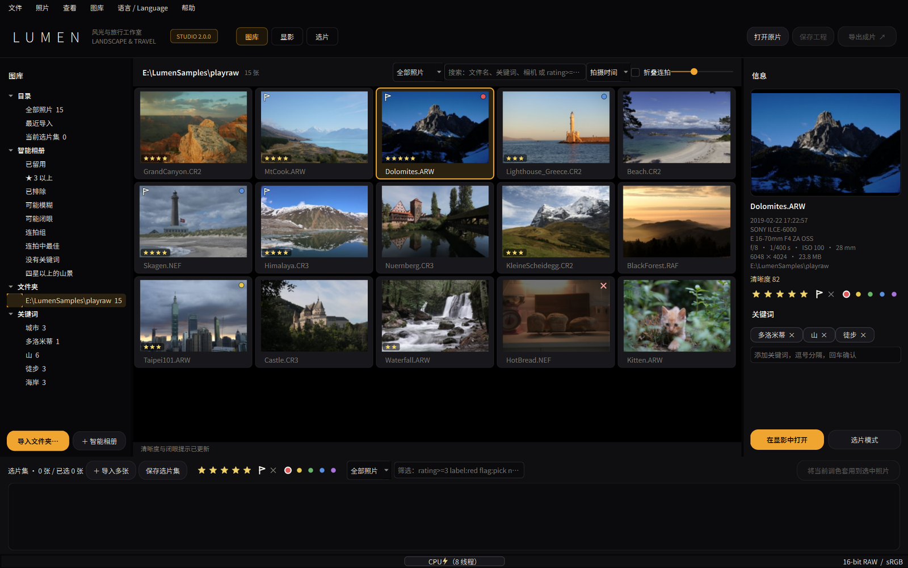
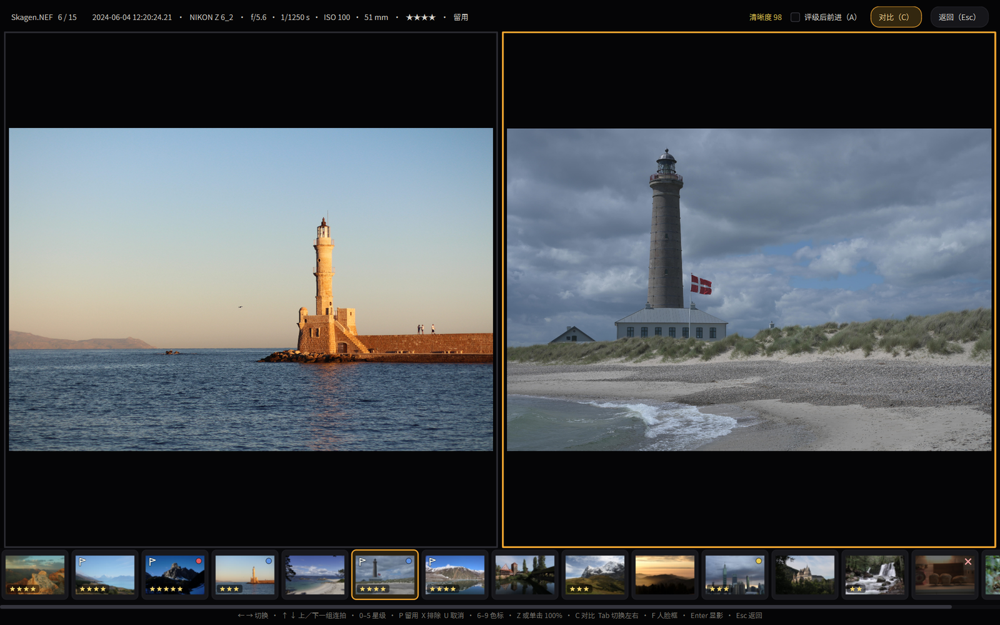
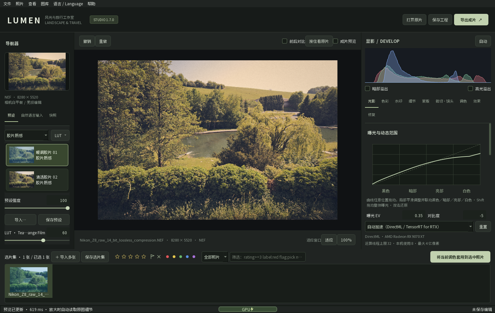
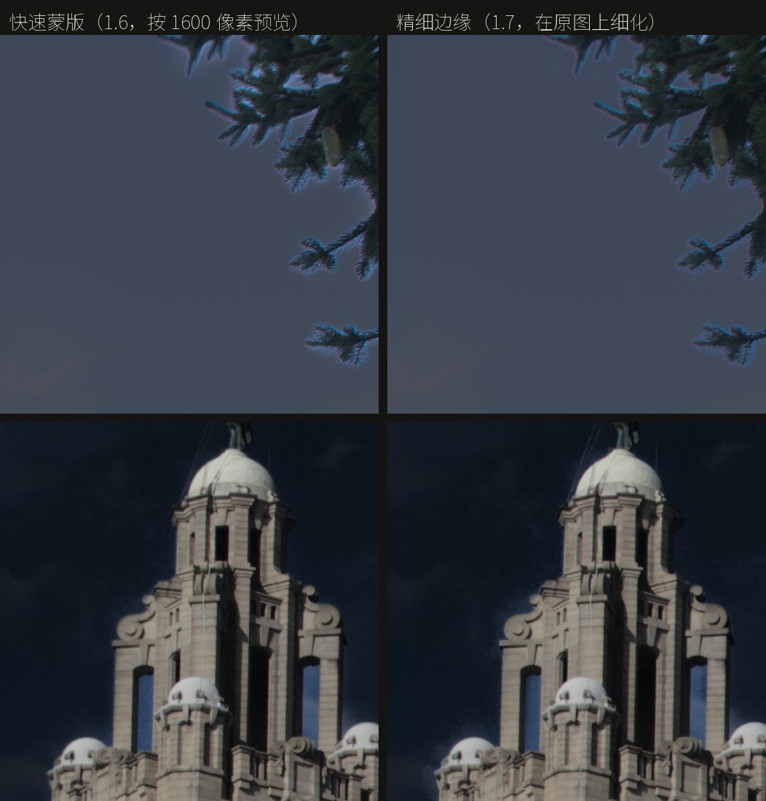
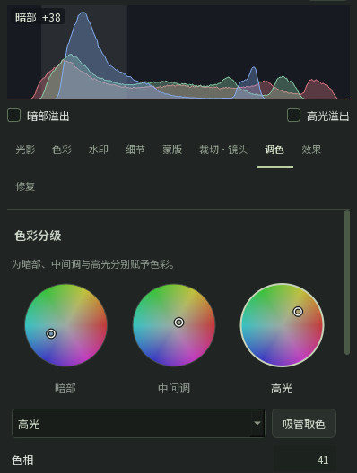
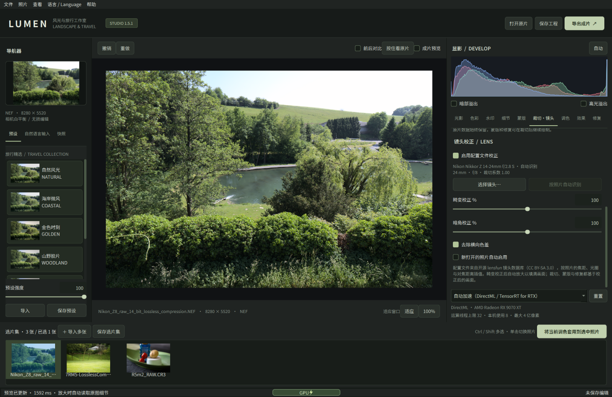
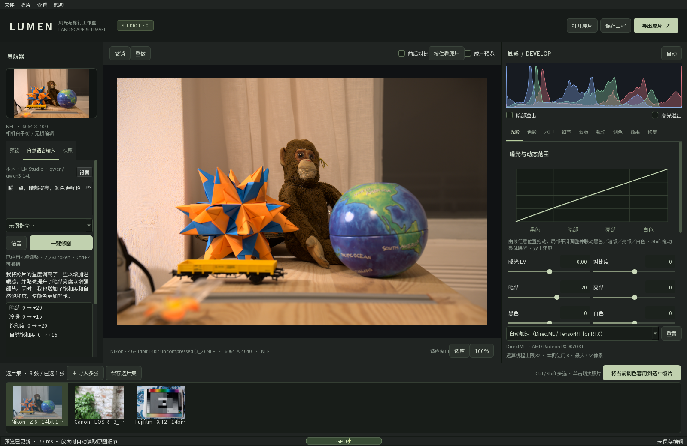
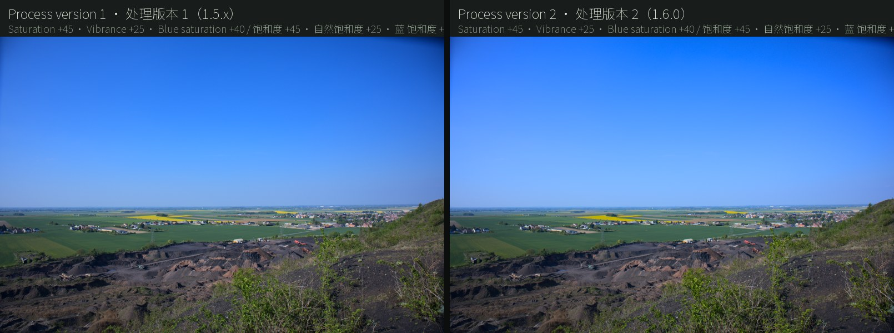
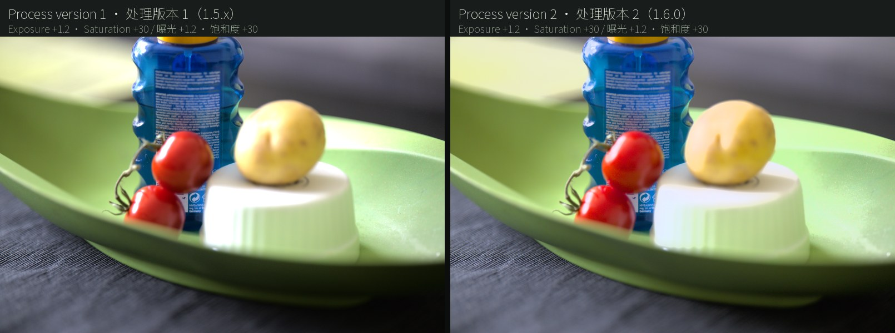
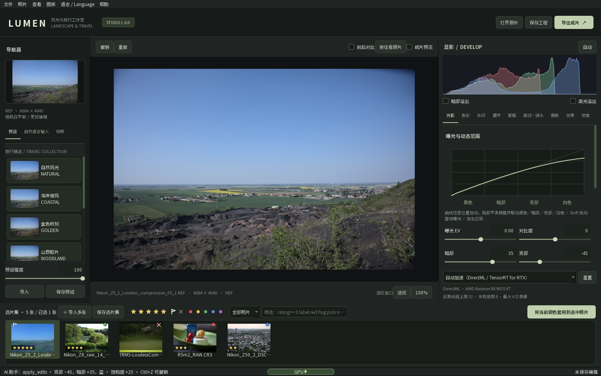

# LUMEN RAW · 多品牌 RAW 工作室

**开源 RAW 照片编辑器：图库与快速选片、调色、镜头校正、AI 增强、智能蒙版、照片合成、延时摄影视频，以及用一句话修图。**

[English](README.md) · [下载](https://github.com/hety0211/lumen-raw/releases) · [更新记录](CHANGELOG.md) · [参与贡献](CONTRIBUTING.md) · [MIT 许可证](LICENSE)

LUMEN RAW 是面向风光与旅行摄影的本地桌面编辑器，支持 Windows 和 Apple 芯片 Mac，无需账号。界面有简体中文、繁體中文、English、日本語、한국어、Deutsch、Français、Español、Русский 九种语言。导入、选片、调色、镜头校正、AI 降噪 / 超分 / 蒙版、导出和延时视频全部在本机离线完成；只有你主动使用云端大模型修图时才会联网发送指令和参数，使用语音指令时会下载一次语音识别模型。

当前版本：**2.0.1**（Windows 2026-10-21）。Mac 版仍为 1.7.0（2026-10-19）。



截图为实际运行界面，照片为公开的测试样片：raw.pixls.us 的 CC0 样片，以及 discuss.pixls.us 上以 CC BY-SA 4.0 发布的 Play Raw 样片（[图片来源](docs/screenshots/README.md)）。

## 下载与安装

| 系统 | 下载 | 要求 |
|---|---|---|
| Windows | [`LumenRAW-2.0.1-Setup.exe`（安装版，415 MB）或 `LumenRAW-2.0.1-Windows.zip`（便携版，477 MB）](https://github.com/hety0211/lumen-raw/releases/tag/v2.0.1) | Windows 10 22H2 / Windows 11，x64 |
| macOS | [`LumenRAW-1.7.0-macOS-arm64.dmg`](https://github.com/hety0211/lumen-raw/releases/tag/v1.7.0-macos)（1.7.0） | Apple 芯片（M1 及更新），macOS 15 Sequoia 或更新 |

2.0.0 暂时没有 Mac 版：图库、选片、预览缓存、延时视频、新主题和更小的安装包目前只有 Windows 版；1.7.0 及以前的功能两个系统相同。2.0.0 没有改变文件格式，工程（`.lumen`）和选片集（`.lumenalbum`）在 2.0.0 与 1.7.0 之间可以互相打开；1.7 及以后保存的无法在 1.6.x 中打开，旧工程在新版本中照常打开，画面不变。下载页附有 SHA-256 校验值。安装包都没有商业代码签名。

**Windows**

- **安装版：** 安装到当前用户目录，不需要管理员权限，可直接覆盖安装 1.2.x – 2.0.0。升级前先保存选片集并关闭旧版。安装开始时选择的语言就是软件的界面语言，之后可在「语言 / Language」菜单中更改。
- **便携版：** 解压后运行 `LumenRAW-Windows\LumenRAW.exe`。`_internal` 文件夹必须留在 exe 旁边。便携版的界面语言默认跟随系统。
- 两种包都自带 Python 运行环境、ExifTool、字体、11 个 AI 模型、视频编码器和 lensfun 镜头数据库，可完全离线使用。语音指令用的识别模型（约 240 MB）在第一次点「语音」时下载；从 1.5 – 1.7 升级安装时，安装程序会保留旧版自带的模型，不必重新下载。
- 2.0.0 的安装包不到 1.7.0 的一半（安装版 880 → 415 MB，便携版 950 → 477 MB），主要是 AI 模型改以半精度存放（结果相差约十万分之一，速度不变）、去掉了用不到的 Qt 组件，以及语音模型不再随包。

**macOS**

- 双击 DMG，把 **LUMEN RAW** 拖到「应用程序」文件夹（覆盖旧版即可）。
- 界面语言默认使用「系统设置 → 通用 → 语言与地区」中第一个受支持的首选语言（也可在该页的「应用程序」中单独给 LUMEN RAW 指定），之后可在「语言 / Language」菜单中更改。1.5.0 Mac 版只有中文界面；如果 Mac 的首选语言是英文，现在首次打开为英文，在「Language」菜单中选「简体中文」即可。
- 安装包是临时签名，没有经过 Apple 公证，第一次打开会被拦截：点「完成」，打开「系统设置 → 隐私与安全性」，在页面下方点「仍要打开」。也可以在终端执行 `xattr -dr com.apple.quarantine "/Applications/LUMEN RAW.app"`。
- 第一次点“语音”时系统会询问麦克风权限，点「允许」。语音只在本机识别，不会上传。
- 云端 API Key 存放在登录钥匙串中。每次更新 App 后第一次使用时，macOS 会询问是否允许读取，输入开机密码并选「始终允许」即可。

## 主要功能

- **图库（2.0.0）：** 把文件夹导入自己的照片目录：文件夹树、可缩放的缩略图网格、关键词和智能相册（按星级、关键词、相机、镜头、日期、清晰度、闭眼、连拍等保存的筛选）。拍摄信息、XMP 中的评级与关键词在后台读取，磁盘上的照片不会被改动。见下方[图库](#图库)。
- **快速选片（2.0.0）：** 全屏显示相机自己的预览，切换照片几乎没有等待；并排对比、100% 放大，评级快捷键与 Lightroom 相同。连拍自动分组并标出最佳一张，并提示可能模糊和闭眼的照片（闭眼由两个小型离线人脸模型判断）。见下方[选片](#选片)。
- **智能预览缓存（2.0.0）：** 打开过的照片再次打开约 50 毫秒（原来 1–2 秒），当前照片前后的照片会提前解码。
- **延时摄影视频（2.0.0）：** 把间隔拍摄的照片做成 H.264、H.265、AV1 或 ProRes 视频，默认与传感器同比例；关键帧之间的调整平滑过渡，去闪烁消除自动曝光与自动白平衡的跳动。见下方[延时摄影视频](#延时摄影视频)。
- **新界面、更小的安装包（2.0.0）：** 琥珀色强调的深色与浅色主题，可跟随系统切换；安装包缩小到不到原来的一半，仍包含全部 AI 模型；CPU 预览快 3–4 倍。
- **预设生态（1.7.0）：** 导入 Lightroom Classic / Camera Raw 预设（`.xmp`、`.lrtemplate`，或整个 `.zip` 预设包），按近似换算成 LUMEN 的参数，并列出没有对应项的设置；`.cube` 3D LUT 作为新的调整项，可调强度、随工程保存；预设按分组管理，可批量套用到选中的照片；内置风格增加到 12 个。见下方[预设、Lightroom 预设与 LUT](#预设lightroom-预设与-lut)。
- **AI 蒙版精细边缘（1.7.0）：** 天空、人物、主体、背景蒙版先快速生成，再读取原图在最长 4096 像素上细化边缘，枝叶、针叶和建筑轮廓更干净，不再留亮边。见下方[AI 蒙版精细边缘](#ai-蒙版精细边缘)。
- **拖动直方图与调色吸管（1.7.0）：** 像 Lightroom 一样在直方图上左右拖动调整黑色、暗部、曝光、亮部与白色；「调色」面板可用吸管从画面取色作为色彩分级的色相。见下方[直方图与调色吸管](#直方图与调色吸管)。
- **场景参考色彩（1.6.0）：** 新的处理版本 2：RAW 解码不再截断色域，曝光、白平衡与亮部／暗部在线性光下计算（亮部／暗部为不产生光晕的局部色调映射），饱和度、八色混合器与色彩分级在 OkLCh 中计算，超出 sRGB 的颜色保持色相与明度压缩。旧工程画面不变。见下方[色彩与处理版本](#色彩与处理版本)。
- **评级（1.6.0）：** 星级、留用／排除旗标、色标，按 Lightroom 的快捷键操作，带字段筛选；自动保存，可与 XMP 互通，可导入 Lightroom 目录中的评级。见下方[评级与筛选](#评级与筛选)。
- **AI 助手与命令行（1.6.0）：** Claude Code、Codex、WorkBuddy 等本地 AI 助手通过 MCP 直接操作 LUMEN RAW（窗口中可见、可撤销）；`lumen-cli` 命令行可批量出图。见下方[AI 助手（MCP）与命令行](#ai-助手mcp与命令行)。
- **镜头校正（1.5.1）：** 按 EXIF 自动识别镜头，用开源 lensfun 数据库校正畸变、暗角和横向色差（边缘紫边／绿边）。见下方[镜头校正](#镜头校正)。
- **九种界面语言（1.5.1）：** 顶部菜单「语言 / Language」随时切换，安装程序也提供同样的九种语言。
- **一句话修图（1.5）：** 输入或说出想要的效果，你选择的本地或云端大模型返回参数，LUMEN RAW 直接应用，一步即可撤销。见下方[自然语言修图](#自然语言修图)。
- **多品牌 RAW：** Sony ARW / SR2 / SRF，Canon CRW / CR2 / CR3，Nikon NEF / NRW，Fujifilm RAF（含 X-Trans），Panasonic RW2，DNG，以及内置 LibRaw 支持的其他格式；也能打开 JPEG / PNG / TIFF。LibRaw 无法解码的尼康“高效率” NEF 改用文件内嵌的全尺寸 JPEG 打开；内置 LibRaw 尚未收录的尼康 Z50 II、Z5 II，无损 NEF 的色彩矩阵由 LUMEN RAW 补上。
- **非破坏性显影：** 曝光、对比度、亮部 / 暗部 / 白色 / 黑色，可在任意位置拖动的曝光曲线，白平衡（读取相机记录色温，带吸管），八色 HSL，RGB 与单通道曲线，三段色彩分级，黑白，暗角与颗粒。另有 12 个内置风格预设（可调强度、可导入导出），可导入 Lightroom 预设和 LUT，以及自动调整、快照和撤销 / 重做。
- **细节与修复：** 去薄雾、清晰度、纹理、锐化、明度 / 彩色降噪；污点修复和仿制图章。
- **蒙版：** 画笔、线性渐变、径向、亮度范围、相似颜色点选，以及本地 AI 识别的天空、人物、主体、背景、近景。可反选、羽化、调不透明度、用画笔补画或擦除，每张照片最多 32 个。
- **AI 增强：** Real-ESRGAN 2× / 4× 超分，DRUNet / NAFNet / FFDNet 去杂色。都有独立预览窗口，结果另存为可继续编辑的 DNG 副本。
- **照片合成：** 景深合成、HDR 堆栈（Mertens 曝光融合，三档去鬼影）、全景（最大 2 亿像素），每次 2–32 张。
- **批量处理：** 在图库网格或底部选片集中用 Ctrl / Shift 多选，可把当前调色套用到选中照片、批量套用预设，或批量导出 JPEG / PNG / TIFF / DNG（可设长边尺寸）。
- **大图查看：** 100% 显示原图像素，只渲染屏幕上看得见的部分；6100 万像素的照片放大调整时，界面最长停顿约 40 ms。支持前后对比、按住看原片和溢出提示。
- **水印与导出：** 四种带拍摄参数的边框水印，按 EXIF 自动显示机身与镜头品牌标志。导出 JPEG / PNG（8 位）、TIFF（16 位）、线性 DNG（16 位），最大 4 亿像素，可选 sRGB、Display P3 或 Adobe RGB 色彩空间，JPEG 可限制文件大小（KB），并保留原片的 EXIF、IPTC 与 XMP（相机、镜头、拍摄参数、版权、关键词；GPS 位置可选）。

## 图库

顶部的 **图库**（`G`，`D` 回到「显影」）是 LUMEN RAW 自己的照片目录。

1. **导入：** 「导入文件夹…」（`Ctrl+Shift+I`，也可以把文件夹拖进网格）在后台导入文件夹及其子文件夹，跳过回收站、系统和隐藏文件夹。照片留在原处，图库只记录它们（数据目录中的 `library.db`）。在显影中打开的照片也会加入图库。
2. **浏览：** 左侧是目录（全部照片、最近导入、当前选片集）、智能相册、带照片数的文件夹树和关键词。网格可按拍摄时间、文件名、星级或导入时间排序，`Ctrl`+滚轮或滑块把缩略图调到 96–320 像素。缩略图上显示星级、旗标、色标、连拍序号和提示标记。
3. **评级与关键词：** `0`–`5`、`P` / `X` / `U`、`6`–`9` 作用于网格中选中的照片，与底部选片集相同。在右侧信息栏输入关键词（逗号分隔，带补全），点关键词上的 × 移除。
4. **打开：** 双击或 `Enter` 在显影中打开所选照片（同时加入选片集）；`C` 或空格开始[选片](#选片)。右键可加入选片集、批量导出、在文件夹中显示、制作延时视频，或从图库移除（只移除记录，文件不动）。

- **搜索与智能相册：** 搜索框和「新建智能相册…」使用与选片集筛选相同的写法，另外支持 `keyword:`（名称、`any` 或 `none`，含空格的名称加引号）、`camera:`、`lens:`、`iso`、`f`、`focal`、`date:2026-10` 或 `date>=2026-10-01`、`faces`、`eyes:closed`、`sharpness<30`、`burst` / `burst:best`，以及词语 `blurry`、`sharp`、`best`、`closed`、`missing`。直接输入的文字同时查找文件名、关键词、相机和镜头。内置八个智能相册：已留用、★3 以上、已排除、可能模糊、可能闭眼、连拍组、连拍中最佳、没有关键词。
- **拍摄信息、评级与关键词** 由 ExifTool 每批 64 张在后台读取，拍摄时间精确到亚秒。XMP 附属文件或内嵌 XMP 中已有的星级、色标和关键词（Lightroom、Bridge 或相机写下的）会直接出现在网格中。开启「评级变化时自动写入 XMP 附属文件」时，关键词也写入附属文件（`dc:subject`，与 Lightroom 相同）；照片本身永远不会被写入。
- **文件夹** 可以「重新扫描」（加入新照片，标出已移动或删除的文件；2.0.1 起被其他软件改过的照片或 XMP 附属文件也会重新读取），也可以从图库移除。
- **读不出信息的文件：** ExifTool 读不了某张照片时（文件损坏、移动硬盘没接好），几分钟后会自动再试；连续 3 次失败后信息栏会说明原因，重新扫描或右键「重新读取拍摄信息」会再试一次。

## 选片



**选片**（`C`，或在网格中按空格）全屏查看网格中的照片（多选时只看所选），也可以从底部选片集开始。

| 操作 | 按键 |
|---|---|
| 下一张 / 上一张 | `→` / `←` |
| 下一组 / 上一组连拍 | `↓` / `↑` |
| 星级 / 旗标 / 色标 | `0`–`5` / `P` `X` `U` / `6`–`9` |
| 开关“评级后前进” | `A` |
| 在指针处放大到 100% 与还原 | `Z`、空格或单击；拖动平移 |
| 并排对比 | `C`；`Tab` 切换评级作用的一侧，`↑` 把候选设为选定 |
| 人脸框 | `F` |
| 在显影中打开 / 返回图库 | `Enter` / `Esc` 或 `G` |

- **速度：** 选片显示相机自己的渲染——RAW 文件内嵌的 JPEG 预览，直接按需要的大小解码——并预读前后各 3 张，切换几乎没有等待。放大到 100% 时，有全尺寸内嵌 JPEG 就直接用，否则读取 RAW。
- **对比：** 左边保持选定的一张，`←` / `→` 更换右边的候选，两边的缩放与位置同步。
- **连拍：** 同一台机身（型号与序列号）、相隔不超过 2 秒、画面相似的连续照片归为一组，显示为“3/7”。每组按“睁眼优先、再取最清晰”选出最佳的一张（琥珀色标记），「折叠连拍」只显示每组最佳。同名同时刻的副本（导出的成片、RAW + JPEG 中的 JPEG）不算连拍。
- **清晰度与闭眼：** 每张照片在后台分析一次（低优先级，AI 处理和导出时暂停；可在「图库」菜单关闭），结果保存在图库中。清晰度（0–100）在画面结构最多的区域测量，所以浅景深照片按清楚的主体计算，雾天不算模糊；低于 22，或比同组最佳低 14 以上，标为“可能模糊”。人脸由 YuNet 检测，再用 Google MediaPipe Face Mesh（478 个关键点）测量眼睛；两只眼都几乎闭上时标为“可能闭眼”。两个模型共约 2.7 MB，离线运行；一张 6100 万像素的 ARW 读预览约 0.3 秒、分析约 0.2 秒。

## 延时摄影视频

在底部选片集中选中一组间隔拍摄的照片（也可以在图库网格中选，会先加入选片集），右键「制作延时视频…」，或用「照片 → 延时摄影视频…」。照片按拍摄时间排列，每张一帧（也可重复最多 10 帧）。

1. **关键帧：** 默认是首尾两张和所有调整过的照片，在对话框中单击照片即可增减。关键帧用自己的调整决定画面，两个关键帧之间的照片平滑过渡：曝光、白平衡、色彩、曲线和分级按比例插值（色相沿色轮最短的方向），不同的裁切变成缓慢的平移和缩放。日落的第一张和最后一张分别调好，视频就会从一种效果过渡到另一种。
2. **去闪烁：** 关 / 轻 / 中 / 强（按相邻 5 / 11 / 25 张平均）。在相机预览上测量每张的亮度，把曝光向相邻照片校正（最多 ±1.5 EV），每张 RAW 记录的白平衡倍率也同样平滑，去掉自动曝光和自动白平衡造成的闪烁与色彩跳动，日落这类缓慢变化保留。
3. **输出：** H.264（MP4）、H.265 / HEVC（MP4，可选 10 位）、AV1（MP4，可选 10 位）或 Apple ProRes 422 HQ（MOV）；原始、4K、2K 或 FHD（长边 3840 / 2560 / 1920 像素，只缩小不放大）；画面比例默认与传感器相同（3:2 相机的 4K 为 3840 × 2560），也可居中裁切为 16:9、4:3、1:1 或 9:16；24–60 帧/秒；最大码率按尺寸自动计算（H.264 的 3840 × 2160 为 80 Mbps，H.265 与 AV1 更低）。对话框中每个选项都直接显示像素尺寸。

- **编码** 优先使用显卡（AMD AMF、NVIDIA NVENC、Intel Quick Sync、Windows Media Foundation），不可用时改用 CPU 的 x264、x265 或 SVT-AV1。视频标注 BT.709，MP4 便于网络播放。每帧只解码到视频需要的大小，后台提前解码两帧，所有帧在同一设备上按顺序渲染。取消或失败时不留下不完整的文件。
- **实测：** Sony A7 III 的 360 张夜景间隔照片（2400 万像素 ARW，自动白平衡）做成 3840 × 2566 的 H.264 视频，显卡编码约 5 分钟；“中”档去闪烁让相邻帧的亮度跳动减少约 60%。
- AI 助手和脚本可以用 `video.timelapse` 命令（MCP 工具 `make_timelapse`），选项相同。

## 预设、Lightroom 预设与 LUT



左侧 **预设** 面板：

1. **导入：** 点「导入…」，选择 Lightroom 预设（`.xmp`、`.lrtemplate`）、预设包（`.zip`）、LUT（`.cube`）或 Lumen 预设（`.lumenpreset`），可一次选多个。导入后弹出报告，列出在 LUMEN 中没有对应项、未能套用的设置。导入的预设保存在数据目录的 `presets` 文件夹，下次启动仍在。
2. **套用：** 上方下拉框按分组筛选（全部、内置风格、各预设包或文件夹）。点预设即套用，「预设强度」在 0–100 之间调节。右键可「套用到选中的 N 张照片」（批量）、导出预设文件、查看导入说明或删除。
3. **LUT：** 分组框旁的「LUT」按钮载入 `.cube` 文件，下方出现以 LUT 名称命名的强度滑块；「移除 LUT」取消。

- **换算是近似的：** LUMEN 的滑块不是 Adobe 的，效果接近 Lightroom，但不会完全一致。映射表、复制不了的 Adobe 行为（相机配置文件与创意 Look、校准面板、局部蒙版等）和换算系数的校准方法见 [docs/LIGHTROOM_PRESETS.md](docs/LIGHTROOM_PRESETS.md)。
- **只改预设包含的设置：** 与 Lightroom 一样，只含颗粒或暗角的预设不会把其他滑块归零。预设中的绝对色温只对有相机色温的 RAW 照片生效（Lightroom 对 JPEG 同样不套用）。
- **预设包：** Windows 压缩工具写成 GBK 的中文文件名能正确读取；同一个预设同时有 `.xmp` 和 `.lrtemplate` 两份时只导入一次；DNG（Lightroom 移动版预设）会跳过并说明原因；再次导入同一个包会覆盖而不是重复。
- **LUT：** 作用在色调映射、调色（曲线、HSL、分级）和局部蒙版之后的显示 sRGB 上，位于暗角与颗粒之前；四面体插值，灰阶保持中性；支持 1D／3D 表、`DOMAIN_MIN`／`DOMAIN_MAX` 和 DaVinci Resolve 的 1D 预整形。LUT 数据随工程、快照和选片集保存，换一台没有 `.cube` 文件的电脑也能打开。
- **保存与分享：** 「保存预设」把当前风格存入预设列表（“我的预设”）；右键「导出预设文件…」得到可分享的 `.lumenpreset`，带 LUT 的预设会把 LUT 一起保存。
- 内置风格共 12 个：自然风光、海岸微风、金色时刻、山野胶片、城市夜景、黑白纪行、日系清新、青橙电影、复古胶片、柔和人像、中画幅影调、暗调情绪。

## AI 蒙版精细边缘



- 「蒙版」面板点天空、人物、主体或背景后，先按预览快速生成蒙版（约 1 秒），然后在后台读取原图（与放大查看共用同一次解码），在最长 4096 像素上细化边缘，完成后自动替换，可撤销。33 MP 的照片从点击到精细蒙版约 7 秒，期间可以继续调整其他参数。之前的版本按 1600 像素预览保存蒙版，导出时放大，边缘发软。
- 细化不需要新的模型：在快速蒙版拿不准的边缘带里，每个像素的颜色被解释为附近前景色与背景色的混合，混合比例就是蒙版值。雾气、远山这类宽过渡保持快速蒙版；天空蒙版不会把反射天空的玻璃当成天空，但能把树枝、电线等细节从天空中切出来。
- 「精细边缘（读取原图，较慢）」默认开启，可关闭；旧工程里的 AI 蒙版可点「精细化所选蒙版」。自然语言修图生成的区域蒙版同样会细化。近景（深度）与相似颜色点选不做细化。

## 直方图与调色吸管



- **拖动直方图：** 与 Lightroom 一样，直方图按色调分成黑色、暗部、曝光、亮部、白色五个区域；指针所在的区域加亮并显示名称与数值，左右拖动即调整对应滑块（拖过整个宽度为 200 点，曝光为 4 EV），每次一步可撤销，双击归零。
- **调色吸管：** 「调色」面板选好暗部、中间调或高光后点「吸管取色」，再点画面中的颜色，就把它作为该区域的色相；该区域尚未着色时同时按颜色的浓淡设置强度。点到接近灰色的地方不会改动。

## 镜头校正



右侧「裁切·镜头」面板，裁切工具下方的 **镜头校正**：

1. 打开照片后，软件按 EXIF 中的机身、镜头型号、焦距、光圈和对焦距离，在 lensfun 数据库（1569 支镜头、1057 台机身）中自动识别镜头，面板上显示识别结果和该配置文件包含哪些校正。
2. 勾选「启用配置文件校正」。「畸变校正 %」「暗角校正 %」可在 0–200% 之间调节，「去除横向色差」可单独关闭。
3. 识别不到或 EXIF 不完整时，点「选择镜头…」按品牌或型号搜索（默认只列出适合该机身卡口的镜头）；「按照片自动识别」恢复自动。勾选「新打开的照片自动启用」后，以后打开的照片默认开启校正。

- 校正参数按照片的焦距、光圈和对焦距离在数据库的标定点之间插值，并按机身裁切系数换算；全画幅机身的 APS-C 裁切模式按 EXIF 等效焦距识别。按更小画幅标定的镜头不会用于更大的画面。
- 校正在显影流程的最前面进行：暗角在线性光下校正，畸变校正后自动放大，不留空白边角。裁切、蒙版、修复、白平衡吸管和 AI 自动蒙版都基于校正后的画面；“按住看原片”和前后对比显示未校正的原片。
- 校正参数随工程保存，导出、批量导出和放大查看都会应用；“将当前调色套用到选中照片”会同步校正开关与强度，每张照片按自己的 EXIF 取得配置文件。
- 校正公式按 lensfun 公布的模型实现（不链接 lensfun 程序库），并与 lensfun 自身的计算结果核对过：色差位置误差小于 0.002 像素。

## 自然语言修图



左侧面板“预设”和“快照”之间的 **自然语言输入**：

1. 点「设置」选择模型服务（见下表），填写模型名称。可以点「获取模型列表」和「测试连接」检查。
2. 输入一句话，如“天空更蓝更有层次，整体暖一点，暗部提亮”，按 Enter 或「一键修图」。也可以从「示例指令」中选一条。
3. 模型返回的说明和每项参数变化显示在结果区。「应用强度」可在 0–150% 之间调节，「撤销本次」恢复修图前，「重新生成」从同一起点再请求一次。同一张照片保留最近三轮对话，可以接着说“再暖一点”。

模型能调整：16 个全局滑块（曝光、对比度、亮部、暗部、白色、黑色、冷暖、色调、饱和度、自然饱和度、去薄雾、清晰度、纹理、锐化、明度降噪、彩色杂点）、八色 HSL、色彩分级、暗角与颗粒、黑白、RGB 曲线，以及天空 / 主体 / 人物 / 背景 / 近景 AI 蒙版和渐变蒙版。返回的每个数值都会校验并限制在有效范围内，不会产生无效工程。指令可以用任何界面语言书写，模型按指令的语言回复说明。

| 类型 | 可选服务 | 说明 |
|---|---|---|
| 本地 | Ollama、LM Studio、llama.cpp（llama-server）、vLLM / Jan / LocalAI 等 OpenAI 兼容服务 | 不需要 API Key，数据不出本机 |
| 云端 | OpenAI、Anthropic Claude、Google Gemini、DeepSeek、阿里云百炼（通义千问）、Kimi、智谱 GLM、硅基流动、火山方舟（豆包）、OpenRouter、自定义接口 | 用你自己的 API Key，按服务商计费 |

- **发送的内容：** 指令、当前调色参数、照片的亮度 / 颜色统计和拍摄参数（机身、镜头、光圈、快门、ISO、焦距、时间，不含 GPS）。可选附带一张长边 768 像素的预览图，给支持图像输入的模型使用。
- **API Key：** 只保存在本机。Windows 上用当前用户的数据保护（DPAPI）加密，macOS 上存放在钥匙串中。
- **思考强度：** 默认 / 关闭 / 低 / 中 / 高 / 最高，自动换算成各家的参数；服务不接受时会去掉该参数重试一次。修图通常用“低”或“关闭”就够：本机 LM Studio + qwen3-14b（RX 9070 XT）一次修图，默认 11.3 秒，关闭思考 1.6 秒。模型刚加载后的第一次请求会更慢。
- **用量：** 每次修图后状态栏显示 token 用量，一次约 2,400 个。实测 DeepSeek（deepseek-flash）测试连接 1 次 + 修图 1 次共 2,486 个 token，花费不到 ¥0.01。附带预览图、多轮对话或换用其他模型时会有变化，以服务商账单为准。
- **语音：** 点「语音」或按 `Ctrl+Shift+Space`（Mac 为 `⌘⇧Space`）说话，停顿约 1 秒自动结束，识别后自动修图（可在设置中关闭）。识别使用 SenseVoice-Small 模型，在本机离线运行，支持中文、英文和中英混说，6 秒语音约 0.1 秒识别完成。Windows 版在第一次点「语音」并同意后下载模型（约 240 MB），来源为 hf-mirror.com 镜像、本项目自己的 GitHub Release 或 Hugging Face，每个文件都核对大小与 SHA-256，中断后可继续下载。Mac 版 1.7.0 仍随包自带。

## 色彩与处理版本

1.6.0 新打开的照片使用 **处理版本 2（场景参考）**；1.6.0 之前保存的工程、选片集仍为处理版本 1，画面与旧版一致。「光影」面板“显影起点”下方显示当前照片的处理版本，旧工程可点「升级」改用版本 2（数值不变、画面会变，可撤销）。

- **不截断的解码：** LibRaw 只做白平衡和去马赛克，相机色彩到 sRGB 的矩阵在浮点中计算，超出 sRGB 的颜色（日落、花、霓虹）保留到最后再处理。
- **线性光中的光影：** 曝光、冷暖／色调、亮部／暗部／白色／黑色在显影曲线之前计算，显影曲线（相机参考或线性）作为色调映射按亮度作用。调低曝光或亮部时，相机曲线压缩在高光里的层次可以拉回来。
- **局部色调映射：** 亮部／暗部按边缘感知的“基底亮度”调整（对数亮度的快速导向滤波），天空、阴影内部的纹理保持原有反差，强边缘不产生光晕，大幅压高光时画面不再发灰。
- **OkLCh 调色：** 饱和度、自然饱和度、八色混合器、黑白与色彩分级在感知均匀的 OkLCh 中计算：给蓝天加饱和度不偏紫、不改变明度；黑白保留感知明度；分级只改色彩不改明度，黑白照片也能分级。
- **高光肩部与色域映射：** 相机参考显影在接近白色处接上滤镜式（filmic）肩部，推过白色的亮度平滑过渡到白；超出 sRGB 的颜色保持色相，主要减少色度（过亮的饱和色略降明度），代替逐通道截断。
- Windows 上处理版本 2 由 DirectML 运行，RX 9070 XT 上 1600 像素预览约 50–60 ms；CPU 模式约 0.65 秒。





## 评级与筛选



图库网格、选片窗口，以及底部选片集的工具栏和缩略图：

| 操作 | 按键 |
|---|---|
| 0–5 星 | `0`–`5` |
| 留用 / 排除 / 取消旗标 | `P` / `X` / `U` |
| 红 / 黄 / 绿 / 蓝色标（再按一次取消） | `6` / `7` / `8` / `9` |

- 作用于选中的照片（没有选中时为当前照片）；右键菜单和「图库」菜单中也有同样的操作。
- **自动保存：** 评级保存在数据目录的 `catalog.jsonl` 中，是只追加的操作日志：每次修改立即写入磁盘，崩溃也不会丢失，不需要保存。选片集同时带上评级，便于在另一台电脑上打开。
- **筛选：** 快速筛选（已留用、未排除、★3 以上……）或输入带字段的条件：`rating>=3 -flag:reject label:red name:DSC0* ext:arw folder:2024 edited`（前加 `-` 表示排除，多个条件同时满足）。图库另外支持关键词、相机、镜头、日期和选片提示等字段（见[图库](#图库)）。
- **XMP：** 导入照片时读取 XMP 附属文件（`照片名.xmp`）或内嵌 XMP 中的星级和色标，Lightroom、Bridge 和相机写下的评级会直接出现。「图库」菜单可把评级写入 XMP 附属文件，或开启“评级变化时自动写入”（默认关闭）。只写附属文件，原片不会被修改；“排除”按 Lightroom 的方式写为 Rating −1。
- **从 Lightroom 迁移：** 「图库 → 导入 Lightroom 目录中的评级…」只读打开 Lightroom Classic 的 `.lrcat`，导入星级、留用／排除和色标（虚拟副本跳过），可选把找到的照片加入选片集。

## AI 助手（MCP）与命令行

LUMEN RAW 的所有操作都是带稳定 id 和 JSON 参数的“命令”（`edit.apply`、`library.rate`、`photo.export`……）。界面的评级、命令面板（`Ctrl+K`）、命令行和 MCP 服务走同一个入口。

**让 AI 助手操作 LUMEN RAW：** 「帮助 → AI 助手接入（MCP）」中有现成的配置，可直接复制：

```
claude mcp add lumen-raw -- "%LOCALAPPDATA%\Programs\LUMEN RAW\lumen-cli.exe" mcp
codex mcp add lumen-raw -- "%LOCALAPPDATA%\Programs\LUMEN RAW\lumen-cli.exe" mcp
```

Mac 上 `lumen-cli` 在 App 内部：

```
claude mcp add lumen-raw -- "/Applications/LUMEN RAW.app/Contents/MacOS/lumen-cli" mcp
```

WorkBuddy、Claude Desktop 等其他客户端使用 JSON 配置（`"command"` 为 `lumen-cli.exe` 的完整路径，Mac 上为 `lumen-cli` 的完整路径，`"args": ["mcp"]`）。之后可以对助手说“把这个文件夹里三星以上的照片按金色时刻预设处理，天空压暗一点，导出到桌面”，或“导入 E:\DCIM，每组连拍只留最清晰、没闭眼的一张，加上关键词‘冰岛’”。

- **LUMEN RAW 打开时：** 助手通过本地控制通道（只有当前用户能连接的命名管道；Mac 上为 Unix 套接字）在窗口中操作，每一步都显示出来，`Ctrl+Z` 即可撤销；状态栏和「AI 助手接入」窗口列出最近的操作，可在该窗口关闭窗口控制。
- **LUMEN RAW 未打开时：** 助手在后台独立打开、调整、渲染和导出照片，照片旁的同名 `.lumen` 工程会被沿用；保存工程或导出前不会写任何文件。
- **工具（32 个）：** 打开照片、读取／应用调整（与自然语言修图同一套参数，含天空、主体等 AI 区域蒙版）、撤销／重做、自动色调、预设、复制调色、星级／旗标／色标、渲染预览（把 JPEG 图像交给助手查看）、导出、批量导出、保存工程、导入 Lightroom 预设与 LUT、精细化 AI 蒙版边缘；2.0.0 新增：把文件夹导入图库、按关键词／相机／日期／清晰度／闭眼／连拍等查找图库中的照片、添加或移除关键词、分析清晰度与闭眼并选出每组连拍的最佳一张、制作延时视频。
- **协议：** stdio，支持 MCP 2026-07-28（无握手）和 2024-11-05 至 2025-11-25（`initialize` 握手）。

**命令行：**

```
lumen-cli render DSC0001.ARW out.jpg --size 2560 --preset 金色时刻 --set exposure=0.3 --set hsl.blue.saturation=20
lumen-cli render DSC0001.ARW out.jpg --preset "暖调胶片 01" --lut 胶片.cube --lut-amount 70
lumen-cli import-presets 大神预设包.zip
lumen-cli render 旅行.lumen out.tif
lumen-cli rate *.ARW 4
lumen-cli list "rating>=3 -flag:reject"
lumen-cli run edit.apply "{\"changes\": {\"adjustments\": {\"highlights\": -40}}}"
lumen-cli run catalog.import "{\"paths\": [\"E:/DCIM\"]}"
lumen-cli run catalog.search "{\"query\": \"burst:best -eyes:closed keyword:冰岛\"}"
lumen-cli run video.timelapse "{\"query\": \"folder:延时\", \"output\": \"夜景.mp4\", \"deflicker\": \"medium\"}"
lumen-cli commands
```

`run` 在 LUMEN RAW 打开时在窗口中执行（加 `--headless` 则始终在后台）。结果为 JSON；从源码运行时用 `python main.py --cli …`。

## 界面语言与外观

- 「查看 → 外观」可选「跟随系统」（默认，Windows / macOS 切换深浅色时立即跟随）、「深色」（近黑底配琥珀色强调，照片周围几乎全黑）或「浅色」（暖白界面配中性灰画布）。选择即时生效并记住；在支持的系统上窗口标题栏也随之变色。主题切换是 2.0.0 的功能，Mac 版暂时没有。
- 顶部菜单「语言 / Language」可选：简体中文、繁體中文、English、日本語、한국어、Deutsch、Français、Español、Русский。选择后提示重新启动，未保存的编辑会先询问保存。
- Windows 安装程序开始时的语言选择提供同样的九种语言，所选语言写入设置，安装后首次启动即为该语言；在软件中切换语言后，下次运行安装程序默认选中当前语言。没有设置时，界面语言跟随系统。
- 日文、韩文和繁体中文界面优先使用系统的对应字体，西文和俄文使用系统界面字体。

## 编辑流程

1. **导入：** 一张存储卡或一次旅行，用「文件 → 导入文件夹到图库…」（`Ctrl+Shift+I`），按 `C` 选片，再按 `Enter` 打开留下的照片；也可以「打开原片」或把照片拖进窗口，直接放进底部选片集。
2. **起步：** 选一个左侧预设、点「自动」，或用自然语言描述想要的效果；需要时在「裁切·镜头」中启用镜头校正。
3. **调整：** 右侧九个面板依次是光影、色彩、水印、细节、蒙版、裁切·镜头、调色、效果、修复。滑块数值可以直接输入，双击滑轨恢复默认。
4. **检查：** 点「100%」或用滚轮放大检查细节，按 `Y` 前后对比，按 `J` 显示溢出。
5. **保存：** `Ctrl+S` 保存当前照片的 `.lumen` 工程；「保存选片集」把选片集里所有照片的编辑存入 `.lumenalbum`。两种文件都只引用原片，原片不会被修改，请和原片放在一起保管。
6. **导出：** 导出时重新读取全尺寸原片并应用全部编辑；多张照片可在选片集或图库中多选后右键「批量导出」。

| 操作 | Windows | macOS |
|---|---|---|
| 导入 / 保存工程 / 导出 | `Ctrl+O` / `Ctrl+S` / `Ctrl+E` | `⌘O` / `⌘S` / `⌘E` |
| 撤销 / 重做 | `Ctrl+Z` / `Ctrl+Shift+Z` | `⌘Z` / `⌘⇧Z` |
| 适应窗口 | `Ctrl+0` | `⌘0` |
| 语音指令 | `Ctrl+Shift+Space` | `⌘⇧Space` |
| 前后对比 / 溢出提示 | `Y` / `J` | `Y` / `J` |
| 确认裁切 / 退出吸管 | `Enter` / `Esc` | `Enter` / `Esc` |
| 仿制图章取样 | `Alt` + 单击 | `Option` + 单击 |
| 平移 / 缩放 | 中键拖动 / 滚轮 | 双指滑动 / 捏合或滚轮 |
| 星级 / 旗标 / 色标 | `0`–`5` / `P` `X` `U` / `6`–`9` | 同左 |
| 图库 / 显影 / 选片（2.0.0，Windows） | `G` / `D` / `C` | — |
| 导入文件夹到图库（2.0.0，Windows） | `Ctrl+Shift+I` | — |
| 命令面板 | `Ctrl+K` | `⌘K` |

## GPU 加速

| 处理 | Windows | macOS |
|---|---|---|
| 逐像素显影（白平衡、曝光、光影、HSL、曲线、分级、黑白等） | DirectML | Metal |
| AI 模型（超分、去杂色、自动蒙版） | NVIDIA RTX 30 系及更新 + Windows 11 24H2：TensorRT for RTX；其他显卡：DirectML | Core ML（Apple GPU） |
| RAW 解码、镜头校正、去薄雾、清晰度、纹理、锐化、传统降噪、修复、合成 | CPU（最多 32 个线程） | CPU |
| 延时视频编码（2.0.0） | AMD AMF、NVIDIA NVENC、Intel Quick Sync 或 Media Foundation；都不可用时 CPU（x264 / x265 / SVT-AV1） | — |
| 清晰度与闭眼提示（2.0.0） | CPU，后台运行 | — |

- GPU 结果在首次使用时与 CPU 核对，失败就自动改用 CPU。底部中间显示 `GPU⚡` 或 `CPU⚡（线程数）`，鼠标悬停可以看设备和回退原因。
- AI 模型在独立进程中运行：显卡驱动崩溃时编辑器不会关闭，会换下一种设备重算，并记住出问题的显卡与驱动组合。
- TensorRT for RTX 组件在第一次使用时由 Windows 下载，之后离线可用。
- 环境变量 `LUMEN_COMPUTE=cpu` 强制使用 CPU。在 Mac 上，`LUMEN_COREML_UNITS=ALL` 允许 Core ML 同时使用神经网络引擎。
- 实测设备：Windows 为 AMD Radeon RX 9070 XT（DirectML），另有社区用户在 GeForce RTX 5080 上测试 TensorRT for RTX；Mac 为 M1 Pro。M1 Pro 上 1600 像素预览的逐像素显影约 3–5 ms，超分和去杂色比 CPU 快 8–10 倍。1600 像素预览启用镜头校正约多 0.1 秒，只在校正参数变化时重算。

## 文件与隐私

| 内容 | Windows | macOS |
|---|---|---|
| 日志 | `%LOCALAPPDATA%\LUMEN RAW\logs` | `~/Library/Logs/LUMEN RAW` |
| 界面语言、镜头校正默认值（`settings.ini`），自然语言设置，GPU 兼容记录 | `%LOCALAPPDATA%\LUMEN RAW` | `~/Library/Application Support/LUMEN RAW` |
| API Key | 设置文件中，DPAPI 加密 | 登录钥匙串（“LUMEN RAW”） |
| 评级目录（`catalog.jsonl`），命令行日志 | `%LOCALAPPDATA%\LUMEN RAW` | `~/Library/Application Support/LUMEN RAW` |
| 导入和保存的预设（`.lumenpreset`） | `%LOCALAPPDATA%\LUMEN RAW\presets` | `~/Library/Application Support/LUMEN RAW/presets` |
| 图库（`library.db`：文件夹、拍摄信息、关键词、智能相册、选片提示） | `%LOCALAPPDATA%\LUMEN RAW` | — |
| 预览缓存（默认上限 4 GB，卸载时删除） | `%LOCALAPPDATA%\LUMEN RAW\cache\previews` | — |
| 语音识别模型（首次使用时下载） | `%LOCALAPPDATA%\LUMEN RAW\models\sensevoice` | 随 App 自带 |

- 原片始终只读。编辑步骤保存在 `.lumen` / `.lumenalbum` 中；AI 和合成结果另存为新的 DNG 文件。从选片集或图库“移除”只是移除记录，不会删除磁盘上的文件。
- 「图库 → 预览缓存」可把缓存上限改为 1–32 GB、关闭或清空，缓存会按需重建；照片在磁盘上被修改后会重新解码。卸载时保留图库与评级。
- 只有三种情况会联网：你使用云端模型修图时、下载语音识别模型时，以及 Windows 第一次下载 TensorRT for RTX 组件时。从源码运行时，首次恢复资源也需要下载。镜头数据库和人脸模型随包提供，识别镜头和选片都不联网。
- 水印边框内置 19 个相机与镜头品牌的标志（商标归各自所有者，来源见 `assets/logos/README.txt`）；唯卓仕、福伦达、三阳、七工匠等其他品牌仍以通用字体显示品牌文字。

## 使用边界

- **镜头校正：** 只能校正 lensfun 数据库中有标定数据的镜头；有的镜头只有畸变数据，没有暗角或色差，面板会注明。变焦镜头需要照片记录焦距，暗角插值需要光圈。鱼眼镜头只校正其投影内的偏差，不转换成直线投影。没有透视（梯形）校正。相机内嵌 JPEG 和机内已校正的照片可能被重复校正，请按需开关。
- **AI 处理的对象：** AI 超分和去杂色处理的是显影后的 RGB 图像，不是传感器原始数据，也不是 Adobe 的 RAW 增强算法；超分生成的纹理可能与真实细节不同，建议先预览。
- **DNG 输出：** 导出的 DNG 是已应用编辑的 16 位线性 RGB，不是原始传感器数据的无损封装。请保留相机原片和工程文件。
- **自动选区：** 1.7.0 起，天空、人物、主体、背景蒙版默认再读取原图、在最长 4096 像素上按颜色精细化边缘，枝叶、针叶和建筑轮廓明显更细，但颜色与背景相近的发丝、反射天空的玻璃、半透明物体仍分不开，网络认错的区域也不会被纠正；“背景”依赖画面中有明确主体。识别后请检查紫色覆盖，用画笔修正。
- **选片提示：** 清晰度和闭眼标记只是提示，不是结论。18 张人像测试中没有把睁眼误判为闭眼，正面闭眼全部识别；但侧脸、大角度、戴墨镜和被遮挡的脸可能漏掉，小于长边 3% 的人脸不计入。有意的虚化（运动模糊、柔焦）同样会被标为模糊。连拍按拍摄时间识别，没有拍摄时间的照片不会分组；同型号的两台机身如果 EXIF 中没有序列号，可能被混在一起。
- **图库：** 每个用户一个图库，窗口、命令行和 MCP 共用；没有人脸识别、地图或查找重复照片。断开的移动硬盘上的照片显示为找不到，接回后恢复。调色仍保存在 `.lumen` / `.lumenalbum` 文件中，不在图库里。
- **延时视频：** 每张照片一帧（可重复），没有帧间混合或运动平滑，也没有音频。去闪烁校正的是整幅画面的亮度和白平衡，不处理路灯等局部闪烁。H.264 与 H.265 受 8K 编码级别限制（更大的原片会缩小）；哪些显卡编码器可用取决于显卡与驱动，不可用时由 CPU 编码。视频由显影后的 sRGB / BT.709 画面生成，不输出 HDR 或 Log。
- **合成：** 全景需要约 30% 以上重叠，尽量绕同一视点拍摄；大视差、运动或重复纹理可能产生接缝。HDR 是 Mertens 曝光融合，不生成辐射度 HDR。合成功能目前只用单张照片生成的受控视图测试过，真实拍摄的序列还需要更多验证。
- **尺寸与资源：**
  - 导出（含水印边框）最大 4 亿像素，2× / 4× 超分后的像素都计入。
  - 大图需要充足的内存和临时磁盘空间，建议 32 GB 内存；CPU 上的高画质 AI 可能很慢。
  - 每张照片最多 32 个蒙版、500 个修复笔划。
- **色彩：** 8 位输入按 ICC 转换到 sRGB，16 位 PNG / TIFF 按 sRGB 处理。没有相机色彩配置文件或显示器软打样。完全过曝的区域不保证能恢复。
- **界面语言：** 切换语言需要重新启动。简体中文以外的译文由开发者完成，欢迎母语用户指正用词。
- **Lightroom 预设：** 可导入 Lightroom Classic / Camera Raw 预设（.xmp、.lrtemplate、.zip 预设包），按近似换算；配置文件、蒙版、校准面板等没有对应项的设置会列出、不套用（见 [docs/LIGHTROOM_PRESETS.md](docs/LIGHTROOM_PRESETS.md)）。照片自带的 XMP 附属文件中的显影设置不会自动读取。
- **不支持：** 导出不完整复制原片的 EXIF / GPS。
- **已实测机型：** Sony A7 III、A7R V，Canon EOS R、R5 Mark II、Rebel SL1，Nikon Z 6、Z8、Z50 II、Z5 II，Fujifilm X-T2，Panasonic DC-S1。其他机型和压缩方式以 LibRaw 的支持范围为准。

## 从源码运行

仓库包含源码、测试、lensfun 镜头数据库、模型来源和许可证；AI 模型（含人脸模型）、字体、ExifTool 和语音模型首次运行前由 `tools/fetch_assets.py` 下载，约 830 MB。脚本会逐个核对 SHA-256，之后编辑可离线运行。延时视频需要 PyAV，`requirements.txt` 会连同它自带的 FFmpeg 一起安装。

**Windows**（Python 3.12 x64）：

```powershell
git clone https://github.com/hety0211/lumen-raw.git
cd lumen-raw
py -3.12 -m venv .venv
.\.venv\Scripts\python.exe -m pip install -r requirements.txt
.\.venv\Scripts\python.exe tools/fetch_assets.py
.\.venv\Scripts\python.exe main.py
```

需要 GPU 加速时，把 ONNX Runtime 换成 Windows ML 版（内含 DirectML，RTX 显卡可用 TensorRT for RTX）：

```powershell
.\.venv\Scripts\python.exe -m pip uninstall -y onnxruntime
.\.venv\Scripts\python.exe -m pip install -r requirements-directml.txt
```

如果已经下载了资源包，可执行 `fetch_assets.py --archive 资源包路径`；`--verify-only` 只做本地校验。之后也可以用 `run-source.cmd` 启动。`requirements-gpu.txt` 提供实验性的 NVIDIA CUDA 源码环境，尚未在 NVIDIA 显卡上验证。环境变量 `LUMEN_LANGUAGE`（如 `en`、`ja`）可临时指定界面语言。

**macOS**（Apple 芯片，Python 3.12，可来自 python.org、Homebrew 或 uv）：

```bash
git clone https://github.com/hety0211/lumen-raw.git
cd lumen-raw
./run-source.command
```

首次运行会创建 `.venv-macos`，安装 `requirements-macos.txt`，并恢复资源和 Perl 版 ExifTool。Python 不在 `PATH` 时，可设置 `LUMEN_PYTHON=/path/to/python3.12`。

## 开发与构建

```powershell
.\.venv\Scripts\python.exe -m pip install -r requirements-dev.txt
.\.venv\Scripts\python.exe -m pytest tests -q
```

- **测试：** 2.0.1 的回归测试在 Windows 上 548 项通过、12 项跳过（macOS 专属等）。测试固定使用简体中文界面。实机验证记录见 [TEST_REPORT.md](TEST_REPORT.md)。
- **界面翻译：** 代码中的界面文字为简体中文原文，经 `tr()` 查找 `lumen/locales/<语言>.json`；`python tools/i18n_catalog.py` 检查各语言的缺漏和占位符。新增界面文字后请同时补充各语言的译文。
- **Windows 发布构建：** `build-release.cmd` 依次执行测试、DirectML 检查、便携版 ZIP 和 Inno Setup 安装包。
- **macOS 发布构建：** `./build-macos.command` 依次执行测试、Metal / Core ML 自检、PyInstaller、临时签名、冒烟测试和 DMG，输出在 `.publish/v<版本>/macos/`。
- **用真实照片自检：**
  - `python main.py --smoke-test 照片 输出目录`：界面、调色、蒙版、AI 预览、逐个加载全部 AI 模型、语音模型（已安装时）、一次自然语言修图、镜头校正、语言目录、图库与选片，以及视频编码。
  - `--workflow-test`：多品牌导入与 AI 副本。
  - `--merge-test`：三种合成。
  - 诊断只读取原片，结果写入新的输出目录。

模型来源、转换方法、许可和校验值见 [MODEL.md](MODEL.md) 与 `assets/models/*.json`；镜头数据库的来源版本见 `assets/lensfun/README.txt`。

## 许可与致谢

程序代码以 **[MIT 许可证](LICENSE)** 发布。第三方依赖、AI 模型、语音模型（FunASR 模型协议 1.1）、lensfun 镜头数据库（CC BY-SA 3.0）、字体和 ExifTool 遵循各自的许可，内置的相机与镜头标志是各自所有者的商标，见 [THIRD_PARTY.md](THIRD_PARTY.md)、[MODEL.md](MODEL.md) 和 `assets/` 中的说明。Windows 安装包为制作延时视频附带 FFmpeg（LGPL-3.0）及 x264、x265 编码库（GPL-2.0 或更高版本，以独立动态库形式提供）。

基于 Python、PySide6 / Qt、NumPy、OpenCV、rawpy / LibRaw、Pillow、tifffile、ONNX Runtime、PyAV / FFmpeg、PyObjC 构建；镜头配置文件来自 [lensfun](https://lensfun.github.io/) 项目；模型来自 Real-ESRGAN、KAIR / DPIR、NAFNet、MiDaS、U²-Net、SkySeg、TorchVision、FunAudioLLM SenseVoice、YuNet（OpenCV Zoo）和 Google MediaPipe Face Mesh；安装界面翻译来自 Inno Setup。

反馈问题或贡献代码请看 [CONTRIBUTING.md](CONTRIBUTING.md)。公开分享样片前，请确认你有权分享，并去掉敏感的位置和人物信息。
